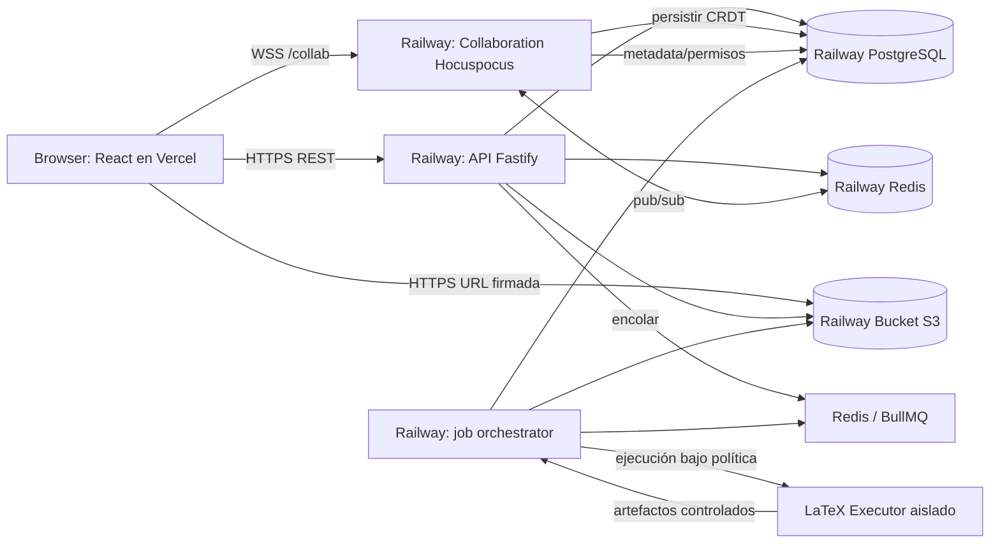
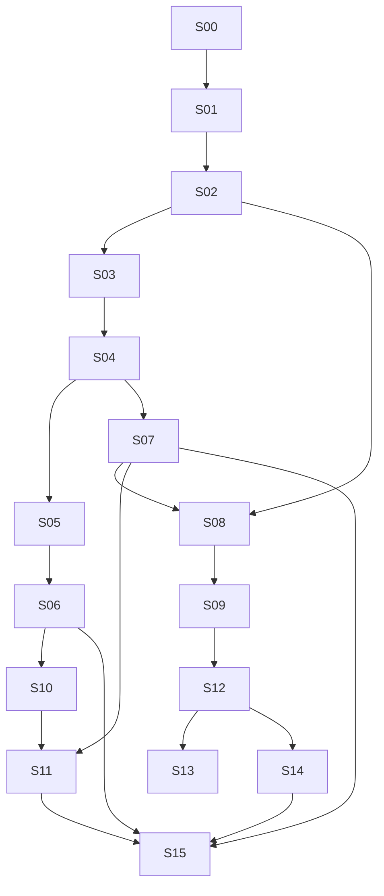

# Plan maestro de implementación: plataforma LaTeX colaborativa tipo Overleaf

> **Documento de ejecución para Codex** · Versión 1.0 · 9 de octubre de 2026  
> **Frontend:** React + TypeScript, desplegado en Vercel.  
> **Backend:** Node.js + TypeScript, desplegado en Railway.  
> **Objetivo:** reproducir la **paridad funcional** de un editor LaTeX colaborativo como Overleaf (incluidas funciones avanzadas), mediante una implementación propia, extensible, auditable y lista para producción.

---

## 0. INSTRUCCIONES OBLIGATORIAS PARA CODEX

**Codex debe leer este archivo completo antes de crear código.** El documento es la especificación fuente de producto, arquitectura, seguridad, pruebas y orden de desarrollo.

1. **No intentar implementar todo en una sola ejecución.** Avanzar por fases y tareas atómicas, con código funcional y verificable al terminar cada una.
2. Al comenzar, inspeccionar el repositorio real y adaptar rutas/comandos sin romper lo existente. Crear `AGENTS.md`, `docs/architecture/`, `docs/adr/`, `docs/progress/` y `docs/test-reports/` si faltan.
3. **Prioridad máxima:** software seguro, compilación LaTeX real, persistencia, edición concurrente sin pérdida de datos y autorización comprobada en servidor. La fidelidad visual viene después de la corrección funcional.
4. No usar mocks en rutas críticas terminadas ni reemplazar la compilación real con un PDF de ejemplo. Un stub solo es válido durante una fase y debe quedar etiquetado `NOT_IMPLEMENTED`, protegido por feature flag y registrado en `docs/progress/OPEN_GAPS.md`.
5. No introducir capacidades ficticias. Una funcionalidad se marca `DONE` únicamente cuando pasa pruebas de unidad, integración y, cuando corresponde, E2E.
6. No copiar código propietario, elementos de marca, textos, logotipos ni recursos con derechos ajenos. **Se busca equivalencia funcional, no suplantar a Overleaf.** Si se reutiliza código de Overleaf Community Edition, revisar expresamente sus obligaciones **AGPL-3.0** antes de incorporarlo.
7. Nunca ejecutar contenido LaTeX no confiable en el mismo proceso o contenedor que la API, el servidor de colaboración o la base de datos. Para usuarios públicos se exige un entorno de ejecución verdaderamente aislado (véase §11).
8. Cada modificación debe incluir pruebas, migración cuando aplique, documentación actualizada y una pequeña nota de decisiones. Evitar cambios masivos de estilo ajenos al objetivo.
9. Toda dependencia, versión y API externa debe verificarse en su documentación **al momento de instalarse**; fijar versiones en `pnpm-lock.yaml`, imágenes Docker por tag/digest y herramientas en el repositorio.
10. Antes de completar cada sprint ejecutar: `pnpm lint`, `pnpm typecheck`, `pnpm test`, `pnpm build` y los tests E2E pertinentes; adjuntar resultados. Si fallan, corregirlos o registrar el bloqueo real.
11. Si falta una credencial externa, implementar el adaptador, ejemplos de variables y pruebas locales simuladas; **no solicitar ni inventar secretos**. La integración queda `BLOCKED_BY_CREDENTIALS`, no `DONE`.
12. Mantener una **Definition of Done global**: API documentada, comportamiento accesible en UI, permisos, persistencia tras reinicio, errores controlados y logs sin información sensible.

### Resultado mínimo exigido en cada turno de Codex

Registrar en `docs/progress/SPRINT-XX.md`: objetivo, tareas completadas, decisiones técnicas, archivos modificados, comandos ejecutados, pruebas que pasan/fallan, deuda técnica y siguiente tarea. No responder solo “implementado”.

---

## 1. ALCANCE, PARIDAD Y CRITERIOS DE ÉXITO

### 1.1. Producto

Una aplicación web multiusuario para crear, importar, editar, compilar, previsualizar, compartir, revisar, versionar y exportar proyectos LaTeX, con **coedición en tiempo real** y compatibilidad práctica con archivos `.tex`, `.bib`, imágenes, estilos, clases y recursos de proyectos académicos.

**Decisión de producto:** inicialmente no imponer planes de pago. Implementar desde el principio `feature_flags` y `usage_quotas` para poder configurar cuotas futuras sin rediseñar el dominio. No prometer compatibilidad absoluta con todas las macros TeX ni paridad de servicios propietarios de terceros; registrar y medir las diferencias.

### 1.2. Niveles y puertas de entrega

| Nivel | Resultado entregable | Condición de cierre |
|---|---|---|
| **MVP operativo — G1** | Cuenta, dashboard, proyecto, árbol de archivos, editor de código, auto-guardado, compilación real segura en entorno autorizado, PDF, logs, ZIP, despliegue | Flujo usuario→crear `.tex`→editar→compilar→descargar pasa E2E |
| **Producto colaborativo — G2** | CRDT, cursores, reconexión, comentarios, permisos, invitaciones, historial básico | Dos sesiones concurren sin perder caracteres; cambio de permisos se aplica en vivo |
| **Paridad editorial avanzada — G3** | editor visual limitado pero honesto, revisión y cambios sugeridos, historial completo, búsqueda global, BibTeX/Biber, SyncTeX, plantillas | Suite de casos LaTeX y revisión aprobada |
| **Paridad de integraciones — G4** | Zotero, Mendeley/Papers según APIs disponibles, GitHub, Git remoto, Dropbox, exportaciones, funciones de ayuda | Pruebas de sincronización/errores/concurrencia por proveedor |
| **Producción pública — G5** | aislamiento fuerte de compilación, auditoría, observabilidad, backups restaurables, límites, multiinstancia, pruebas de carga y seguridad | No se habilita registro público de desconocidos antes de pasar seguridad |

**Distinción indispensable:** G1 puede validarse con un grupo de usuarios **de confianza**, usando un trabajador LaTeX separado y endurecido; eso **no convierte a Railway por sí solo en un sandbox seguro** para compilar documentos de personas desconocidas. G5 exige un executor aislado cuyo aislamiento esté verificado.

### 1.3. Requisitos no funcionales: objetivos de diseño, no promesas

| ID | Objetivo verificable | Prueba |
|---|---|---|
| NFR-01 | No perder ediciones confirmadas ante reinicio del servidor | Kill/restart controlado + reconexión + comparación de contenido |
| NFR-02 | Convergencia de 5 editores simultáneos | Tests CRDT y Playwright multi-contexto |
| NFR-03 | Cambio de usuario revocado efectivo en API y WebSocket | Revocar en sesión A, intentar escribir desde B |
| NFR-04 | p95 de operaciones CRUD sin compilación ≤ 500 ms en entorno de prueba dimensionado | k6 con dataset publicado y límites de hardware indicados |
| NFR-05 | p95 de propagación remota de edición ≤ 300 ms en red de prueba local | Instrumentación cliente-a-cliente; no garantizar Internet global |
| NFR-06 | PDF generado corresponde exactamente a una revisión congelada | Verificar `sourceRevision` + hash del manifiesto |
| NFR-07 | Jobs concurrentes y por usuario dentro de cuotas | Prueba de saturación, rate limit y colas |
| NFR-08 | WCAG 2.2 AA como objetivo de interfaz; navegación por teclado | axe-core + revisión manual |
| NFR-09 | Recuperación de backup probada periódicamente | Restore automatizado en staging |
| NFR-10 | Cero credenciales, tokens o contenido privado en logs de aplicación | Tests de redacción y revisión CI |
| NFR-11 | Funciones críticas utilizables en Chrome, Firefox y Edge recientes | Playwright en matriz de navegadores |
| NFR-12 | Sin escrituras silenciosamente descartadas en modo offline | Pruebas de desconexión, reintento, conflicto y sincronización |

---

## 2. MATRIZ EXHAUSTIVA DE FUNCIONALIDADES

**Leyenda:** `P0` esencial, `P1` paridad avanzada, `P2` integración/escala. Cada fila es trabajo real y debe convertirse en issue/tarea y test. El inventario toma como referencia las capacidades públicas documentadas por Overleaf en octubre de 2026; no implica copia de su implementación.

### 2.1. Cuenta, sesión y preferencias

| ID | Prioridad | Función | Comportamiento y aceptación |
|---|---|---|---|
| ACC-01 | P0 | Registro y acceso | Email+contraseña, verificación de email, cierre de sesión, recuperación con token de un solo uso |
| ACC-02 | P0 | Gestión segura de sesiones | Cookies `HttpOnly`, `Secure`, política SameSite, expiración, rotación, revocación, lista de sesiones |
| ACC-03 | P0 | Perfil | Nombre, avatar, correo, idioma, zona horaria y preferencias |
| ACC-04 | P1 | OAuth | Google/GitHub opcionales, vinculación/desvinculación, asociación segura de identidades |
| ACC-05 | P1 | Preferencias del editor | Fuente, tamaño, tema claro/oscuro, ancho de tab, wrap, autocierre, autocompletar, accesibilidad |
| ACC-06 | P1 | Seguridad de cuenta | Cambio de contraseña, invalidación de sesiones, MFA TOTP opcional |
| ACC-07 | P2 | Privacidad y datos | Exportar datos, borrar cuenta bajo reglas de propiedad compartida, política de retención |
| ACC-08 | P2 | Notificaciones | In-app y correo para invitaciones, menciones, respuestas y cambios importantes |

### 2.2. Dashboard, proyectos y archivos

| ID | Prioridad | Función | Comportamiento y aceptación |
|---|---|---|---|
| PRO-01 | P0 | Dashboard | Mis proyectos, compartidos, recientes, búsqueda, paginación, orden por modificación y propietario |
| PRO-02 | P0 | Crear proyectos | Vacío, ejemplo mínimo, de plantilla propia y desde `.zip` |
| PRO-03 | P0 | Metadatos | Renombrar, duplicar, propiedad, fechas, descripción opcional |
| PRO-04 | P0 | Gestión de archivos | Crear/renombrar/mover/borrar archivos/carpetas; impedir rutas duplicadas, traversal y ciclos |
| PRO-05 | P0 | Subidas | `.tex`, `.bib`, `.sty`, `.cls`, `.bst`, imágenes, PDF, fuentes autorizadas; drag-drop, progreso, errores |
| PRO-06 | P0 | Descargas | ZIP de fuente, PDF generado, logs y artefactos permitidos |
| PRO-07 | P0 | Documento raíz | Elegir `.tex` principal; validar que exista y sea editable |
| PRO-08 | P1 | Archivar y papelera | Archivo no equivale a borrado; restaurar y borrar permanentemente con confirmación |
| PRO-09 | P1 | Etiquetas | Etiquetas de usuario, colores y filtrado; relaciones muchos-a-muchos |
| PRO-10 | P1 | Importación de proyectos | ZIP con subcarpetas, preservando estructura y sin ZIP slip ni ZIP bombs |
| PRO-11 | P1 | Plantillas | Catálogo, filtros, vista previa, plantillas versionadas y creación desde plantilla |
| PRO-12 | P1 | Operaciones masivas | Seleccionar/archivar/etiquetar varios proyectos, permisos individualizados |
| PRO-13 | P1 | Transferencia de propiedad | Aceptación explícita del nuevo propietario y reversión en caso de fallo |
| PRO-14 | P2 | Enlace a archivos externos | Importar recursos desde URL permitida, con defensa SSRF o mediante conectores específicos |
| PRO-15 | P2 | Estadísticas del proyecto | Conteo de palabras útil para LaTeX, tamaño, cantidad de archivos, última compilación |

### 2.3. Editor de código LaTeX

| ID | Prioridad | Función | Comportamiento y aceptación |
|---|---|---|---|
| EDT-01 | P0 | Editor CodeMirror 6 | Syntax highlighting LaTeX/BibTeX, líneas, selección, indentación, undo/redo |
| EDT-02 | P0 | Autosave | Estado `guardando/guardado/sin conexión/error`, sin sobrescrituras por carreras |
| EDT-03 | P0 | Multiarquivo | Pestañas o selector, cambio instantáneo con buffers conservados |
| EDT-04 | P0 | Atajos básicos | Guardar, deshacer, rehacer, comentar, búsqueda, compilar, saltar a línea |
| EDT-05 | P1 | Inteligencia de edición | `\begin...\end`, pares de llaves, snippets, folding, match de delimitadores |
| EDT-06 | P1 | Autocompletar | Comandos, entornos, etiquetas, `\cite`, archivos en `\input` / `\includegraphics` |
| EDT-07 | P1 | Diagnósticos | Subrayar error por archivo/línea; warnings y navegación desde log |
| EDT-08 | P1 | Buscar y reemplazar | Archivo actual y proyecto, regex opcional, vista de coincidencias |
| EDT-09 | P1 | Inserciones guiadas | Figura, tabla, sección, listas, enlaces, fórmulas, referencias, citas |
| EDT-10 | P1 | Paleta de símbolos | Búsqueda por nombre/categoría y pegado de comandos matemáticos |
| EDT-11 | P1 | Idioma/ortografía | Diccionarios y revisión local de texto sin alterar comandos LaTeX |
| EDT-12 | P1 | Menú de configuración | Motor, raíz, TeX Live disponible, recompilación automática, timeout configurable por plan |
| EDT-13 | P2 | Editor visual | Véase §10; soportar elementos conocidos con límites visibles y salida sin pérdida |
| EDT-14 | P2 | Ayuda contextual | Guía de comandos, documentación, explicaciones de errores, opcional IA con consentimiento |

### 2.4. Compilación y visor PDF

| ID | Prioridad | Función | Comportamiento y aceptación |
|---|---|---|---|
| CMP-01 | P0 | Compilación real | pdfLaTeX con TeX Live y `latexmk`; PDF real almacenado en bucket privado |
| CMP-02 | P0 | Logs | Errores, advertencias, archivo y línea, stdout/stderr seguros, estado de compilación |
| CMP-03 | P0 | Visor | PDF.js: zoom, navegación, páginas, ajuste a ancho/página, descarga |
| CMP-04 | P0 | Cola | `queued/running/succeeded/failed/timed_out/cancelled`; idempotencia, timeout, límite por usuario |
| CMP-05 | P1 | Motores | XeLaTeX, LuaLaTeX y ruta LaTeX→DVI→PDF cuando sea compatible |
| CMP-06 | P1 | Bibliografía | BibTeX y Biber/biblatex; resolver múltiples pasadas con `latexmk` |
| CMP-07 | P1 | SyncTeX | Ir de código a PDF y de PDF a código usando `.synctex.gz` y un servicio de consulta seguro |
| CMP-08 | P1 | Compilación automática | Debounce, cancelación/coalescing de jobs pendientes, nunca interrumpir a ciegas un job persistido |
| CMP-09 | P1 | Artefactos | PDF, `.log`, `.blg`, `.synctex.gz` y archivos permitidos, con limpieza/retención |
| CMP-10 | P1 | Recompilación limpia | Limpiar caché auxiliar y comparar resultados reproducibles cuando corresponda |
| CMP-11 | P1 | Caché | Hash de inputs + motor + versión de TeX Live + opciones; invalidación correcta |
| CMP-12 | P2 | Compiladores especiales | Paquetes, fuentes y clases adicionales; registrar compatibilidad y excepciones |

### 2.5. Colaboración, revisión e historial

| ID | Prioridad | Función | Comportamiento y aceptación |
|---|---|---|---|
| COL-01 | P0 | Coedición en tiempo real | CRDT Yjs; edición simultánea, convergencia, sincronización con reconexión |
| COL-02 | P0 | Presencia | Usuarios conectados, alias/color, archivo activo, cursores y selección compartida |
| COL-03 | P0 | Permisos | OWNER, EDITOR, REVIEWER, VIEWER; checks en REST y WebSocket |
| COL-04 | P0 | Invitaciones | Email, aceptar/rechazar/revocar, expiración, evitar accesos fuera del proyecto |
| COL-05 | P1 | Compartir mediante link | Tokens aleatorios de alta entropía, rol permitido, vencimiento, revocación y límites |
| COL-06 | P1 | Comentarios anclados | Crear, mencionar, responder, resolver, reabrir, borrar conforme a permisos |
| COL-07 | P1 | Chat de proyecto | Mensajes en tiempo real, histórico paginado, presencia y permisos |
| COL-08 | P1 | Revisión | Modo edición/revisión/lectura; el REVIEWER nunca modifica documento final sin aceptación |
| COL-09 | P1 | Cambios sugeridos | Inserción/borrado/reemplazo, autor y tiempo, aceptación/rechazo individual o masivo |
| COL-10 | P1 | Historial completo | Revisiones consistentes, autor, instante, etiquetas, comparación entre versiones |
| COL-11 | P1 | Restauración | Proyecto completo o archivo aislado, incluyendo metadatos asociados cuando proceda |
| COL-12 | P1 | Control de conflictos | Recuperación después de 2 clientes offline, renombrados, borrados y edición concurrente |
| COL-13 | P2 | Notificaciones de colaboración | Menciones, respuestas, invitaciones, actividad importante con preferencias |
| COL-14 | P2 | Auditoría | Quién creó/invitó/descargó/restauró/revocó; nunca guardar contraseñas/contenido innecesario |

### 2.6. Bibliografía, integraciones y capacidades complementarias

| ID | Prioridad | Función | Comportamiento y aceptación |
|---|---|---|---|
| INT-01 | P1 | `.bib` | Crear/editar/importar/exportar, detectar claves duplicadas, autocompletar `\cite{}` |
| INT-02 | P1 | Búsqueda de referencias | Por clave, título, autor, DOI, año dentro del proyecto |
| INT-03 | P2 | Zotero | OAuth/API conforme a permisos, importar bibliotecas a `.bib`, refrescar, protección de tokens |
| INT-04 | P2 | Mendeley/Papers | Adaptadores cuando las APIs comerciales/planes y licencias lo permitan |
| INT-05 | P2 | GitHub | Conexión OAuth, elegir repo/rama, pull/push/estado, prevención de overwrite y conflicto |
| INT-06 | P2 | Git remoto | Endpoint Git HTTP autenticado **separado** de sincronización GitHub, con semántica definida |
| INT-07 | P2 | Dropbox | Export/sync según API y permisos aprobados, revocación y conflictos |
| INT-08 | P2 | Importación/exportación BibTeX | Normalizar cuando sea seguro, preservar el original cuando no lo sea |
| INT-09 | P2 | Asistencia de escritura | Corrección/gramática y explicación de errores con proveedor opcional, sin enviar manuscritos sin opt-in |
| INT-10 | P2 | Publicación/compartición | Enlace a PDF con expiración, descarga ZIP, enlace de lectura controlada |
| INT-11 | P2 | Administración | Panel de cuotas, jobs, usuarios, reportes, métricas, bloqueo de abuso y flags |

### 2.7. Matriz de permisos (obligatoria, nunca solo en el cliente)

| Operación | Owner | Editor | Reviewer | Viewer |
|---|:---:|:---:|:---:|:---:|
| Abrir proyecto/PDF | ✓ | ✓ | ✓ | ✓ |
| Editar `.tex` directamente | ✓ | ✓ | — | — |
| Crear/renombrar/borrar archivos | ✓ | ✓ | — | — |
| Compilar manualmente | ✓ | ✓ | ✓* | ✓* |
| Comentar y responder | ✓ | ✓ | ✓ | — |
| Proponer cambios | ✓ | ✓ | ✓ | — |
| Aceptar/rechazar sugerencias | ✓ | ✓ | — | — |
| Invitar/cambiar roles/links | ✓ | — | — | — |
| Restaurar versiones | ✓ | ✓ | — | — |
| Transferir propiedad / eliminar definitivo | ✓ | — | — | — |
| Exportar fuente | ✓ | ✓ | según política | según política |

`*` Permitido solo bajo cuota y política explícita; el compilador debe operar con contenido autorizado y límites globales. Enlaces compartidos no conceden permisos implícitos adicionales. Roles y política de exportación se representan en el backend como capacidades explícitas.

---

## 3. ARQUITECTURA DE REFERENCIA

### 3.1. Stack seleccionado

| Capa | Elección principal | Justificación y notas |
|---|---|---|
| Frontend | **React + TypeScript + Vite** | SPA que se aloja de forma sencilla en Vercel; separación clara de WebSockets |
| Monorepo | **pnpm workspaces + Turborepo** | Dependencias, tipos API y ejecución de tareas compartidos |
| UI | Tailwind CSS + shadcn/ui + Radix | UI accesible y personalizable, sin copiar identidad visual ajena |
| Estado servidor | TanStack Query | Caché, invalidación, reintentos y estados de consulta |
| Estado interfaz | Zustand o estado React local | No mezclar estado de UI con CRDT |
| Routing | React Router o TanStack Router | Rutas protegidas y manejo de parámetros tipados |
| Editor | CodeMirror 6 + `y-codemirror.next` | Editor modular e integración Yjs |
| Motor colaboración | **Yjs 13 estable + Hocuspocus (versión compatible)** | CRDT, awareness, autenticación y persistencia extensible |
| API | **Fastify + TypeScript + Zod + OpenAPI** | Backend ligero; REST tipado, límites y validación |
| PostgreSQL | Railway PostgreSQL | Datos transaccionales, permisos, historial, jobs y CRDT persistido |
| ORM | **Drizzle ORM + migraciones SQL** | Migraciones explícitas, consultas tipadas, control de índices/constraints |
| Redis | Railway Redis + BullMQ | Pub/sub, coordinación entre instancias, rate limits y trabajos en cola |
| Tiempo real escalado | Hocuspocus + extensión Redis compatible | Broadcast de documentos y presencia entre réplicas |
| Objetos | **Railway Storage Buckets (S3-compatible)** | Binarios, ZIP, PDFs, snapshots grandes y plantillas |
| PDF | PDF.js (`pdfjs-dist`) | Visualización con navegación y futuras coordenadas SyncTeX |
| Compilación | TeX Live + latexmk en servicio **aislado de la API** | Motores completos, logs y artefactos; aislamiento fuerte exigido al publicar |
| Jobs | BullMQ con worker | Estado durable, cuotas, reintento y monitoreo |
| Calidad | Vitest, Testing Library, Playwright, Supertest/`fastify.inject`, k6 | Pirámide de tests y escenarios concurrentes |
| Monitoreo | OpenTelemetry, Sentry opcional, métricas/logs estructurados | Diagnóstico sin filtrar archivos privados |
| CI/CD | GitHub Actions + Vercel + Railway | Tests, migraciones controladas y despliegues independientes |

> **Compatibilidad de versiones:** no instalar automáticamente la versión más nueva de Yjs o Hocuspocus si el binding CodeMirror no la soporta. Codex debe comprobar versiones peer dependency y fijarlas. La rama experimental Yjs 14 / `@y/codemirror` no debe desplazar la combinación estable sin suite de migración.

### 3.2. Topología



**Servicios de Railway recomendados:** `api` (público), `collab` (público WSS), `jobs` (privado), `postgres` (privado), `redis` (privado), `bucket` (privado vía SDK), `tex-executor` (privado, para entornos confiables; un executor más fuerte para producción pública). **No** montar volúmenes persistentes en API/colaboración si se pretende escalar con réplicas: Railway no permite réplicas en servicios con volumen. Usar PostgreSQL, Redis y bucket para persistencia.

**Notas verificadas del hosting a octubre de 2026:** Railway soporta WebSockets y réplicas; no ofrece sticky sessions en el balanceador. Vercel habilitó WebSockets en Functions en junio de 2026 (beta), pero **no se usarán** para este proyecto porque la colaboración persistente ya se hospedará en Railway. Railway ofrece buckets S3 compatibles: usarlos en lugar de añadir S3/R2 salvo que los límites o costos lo justifiquen.

### 3.3. Dominios y autenticación

- Producción recomendada: `app.tudominio.com` → Vercel, `api.tudominio.com` → Railway, `collab.tudominio.com` → Railway.
- Ambos subdominios API/colaboración bajo el mismo dominio registrable permiten una política SameSite coherente. Cookie de sesión `HttpOnly`, `Secure`, preferir host-only en `api` y emitir **ticket WSS de corta duración** autenticado desde API.
- Evitar depender de cookies de terceros entre `*.vercel.app` y `*.railway.app`; los navegadores pueden bloquearlas. Para previsualizaciones, configurar un dominio/proxy coherente o un mecanismo alternativo explícito y probado.
- `VITE_API_URL`, `VITE_COLLAB_URL` son públicas y **no** contienen secretos. CORS con allowlist exacta, credenciales solo para orígenes autorizados. Validar `Origin` también al conectar por WSS.
- `api` y `collab` escalan sin sticky sessions; Redis extiende el plano de sincronización, PostgreSQL sigue siendo el origen durable.
- Red interna Railway: `jobs`, PostgreSQL y Redis nunca deben exponer un dominio público.

### 3.4. Repositorio propuesto

```text
latex-workspace/
├── AGENTS.md
├── PLAN_IMPLEMENTACION_EDITOR_LATEX_COLABORATIVO.md
├── README.md
├── package.json                  # workspaces scripts
├── pnpm-workspace.yaml
├── pnpm-lock.yaml
├── turbo.json
├── .github/workflows/
│   ├── ci.yml
│   ├── security.yml
│   └── migrations.yml
├── apps/
│   ├── web/                      # Vite, React, rutas y UI
│   │   ├── src/
│   │   │   ├── app/              # providers, router, guards
│   │   │   ├── routes/           # login, dashboard, project, settings
│   │   │   ├── features/         # projects, editor, pdf, collab, history, review...
│   │   │   ├── components/       # ui, layout, dialogs
│   │   │   ├── lib/              # api client, auth, websocket, telemetry
│   │   │   └── styles/
│   │   ├── public/
│   │   └── vercel.json
│   ├── api/                      # Fastify HTTP REST
│   │   └── src/{plugins,modules,policies,lib,server.ts}
│   ├── collab/                   # Hocuspocus WSS y durabilidad CRDT
│   │   └── src/{auth,persistence,awareness,server.ts}
│   ├── jobs/                     # consumidores BullMQ y orquestación
│   │   └── src/{compilation,exports,sync,maintenance,worker.ts}
│   └── tex-executor/             # imagen/sandbox: NUNCA API
│       ├── Dockerfile
│       ├── entrypoint.sh
│       ├── texmf.cnf
│       └── src/
├── packages/
│   ├── db/                       # Drizzle schema, migrations, seeds
│   ├── contracts/                # schemas Zod/DTO/WS events
│   ├── auth/                     # políticas reutilizables, NO secretos cliente
│   ├── latex/                    # análisis AST, referencias, parseo de logs
│   ├── editor/                   # extensiones CM6, snippets, bindings
│   ├── storage/                  # S3 adapter y claves de objetos
│   ├── config/                   # configuración validada por entorno
│   ├── ui/                       # componentes reutilizables (opc.)
│   └── test-utils/               # factories, fixtures y helpers
├── infra/
│   ├── docker-compose.yml        # PostgreSQL, Redis, MinIO dev, mail catcher
│   ├── railway/                  # configuración por servicio
│   ├── scripts/                  # setup, seed, smoke, backup-restore
│   └── policies/                 # políticas del executor y amenazas
├── tests/
│   ├── e2e/
│   ├── integration/
│   ├── load/
│   ├── security/
│   └── fixtures/latex-projects/
└── docs/
    ├── architecture/
    ├── adr/
    ├── api/openapi.json
    ├── operations/
    ├── progress/
    ├── test-reports/
    ├── feature-parity.md
    └── OPEN_GAPS.md
```

**Ruta de despliegue Vercel:** root directory `apps/web` (o comando de build monorepo aprobado), salida `dist`, rewrite SPA a `index.html` sin interceptar `/assets/*`. **Railway:** crear proyectos/servicios separados con Dockerfiles o comandos explícitos para `apps/api`, `apps/collab`, `apps/jobs`; la imagen TeX tiene otra cadena de build.

---

## 4. MODELO DE DATOS RELACIONAL

Usar UUID/UUIDv7 o ULID según decisión documentada; `timestamptz` siempre UTC. Todas las tablas relacionadas con proyectos exigen índices de pertenencia. Migraciones SQL revisables. Adoptar `deleted_at` solo donde sea necesario, no como excusa para omitir eliminación física bajo políticas de retención.

### 4.1. Entidades, campos e índices fundamentales

| Tabla | Campos mínimos | Constraints e índices |
|---|---|---|
| `users` | `id`, `email_normalized`, `password_hash?`, `display_name`, `avatar_key?`, `email_verified_at?`, `created_at`, `disabled_at?` | `UNIQUE(email_normalized)`; hash Argon2id |
| `user_preferences` | `user_id`, `locale`, `timezone`, `theme`, `editor_settings_json`, `notification_settings_json` | PK `user_id` |
| `sessions` | `id`, `user_id`, `token_hash`, `expires_at`, `last_seen_at`, `revoked_at`, `device_label` | índice `user_id`, `expires_at`; token nunca en claro |
| `auth_identities` | `id`, `user_id`, `provider`, `provider_subject` | `UNIQUE(provider,provider_subject)` |
| `verification_tokens` | `id`, `user_id`, `purpose`, `token_hash`, `expires_at`, `used_at` | un solo uso, purga programada |
| `projects` | `id`, `owner_id`, `title`, `description`, `main_file_id?`, `compiler`, `texlive_image_version`, `status`, `current_revision`, `created_at`, `updated_at` | índices owner/status/updated; FK raíz diferida o en 2 pasos |
| `project_members` | `project_id`, `user_id`, `role`, `joined_at`, `revoked_at?` | `UNIQUE(project_id,user_id)` para miembro activo mediante índice parcial |
| `project_invitations` | `id`, `project_id`, `email_normalized`, `role`, `token_hash`, `expires_at`, `accepted_at`, `invited_by` | índice expiración; bloqueo de duplicados pendientes |
| `share_links` | `id`, `project_id`, `token_hash`, `role`, `expires_at?`, `max_uses?`, `use_count`, `revoked_at` | lookup por hash; roles de link restringidos |
| `project_nodes` | `id`, `project_id`, `parent_id?`, `name`, `kind=FILE/FOLDER`, `mime`, `size_bytes`, `content_kind=TEXT/BINARY`, `blob_key?`, `deleted_at?` | unicidad `(project_id,parent_id,name)` **activa**; validar parent del mismo proyecto |
| `project_tags` | `id`, `user_id`, `name`, `color` | `UNIQUE(user_id,name)` |
| `project_tag_links` | `project_id`, `tag_id` | PK compuesta |
| `text_documents` | `file_id`, `project_id`, `latest_snapshot_id?`, `last_persisted_seq`, `updated_at` | 1:1 `project_nodes`, TEXT solamente |
| `crdt_updates` | `id`, `file_id`, `seq`, `actor_user_id?`, `payload_bytes`, `created_at` | `UNIQUE(file_id,seq)`; conservar hasta snapshot verificado |
| `crdt_snapshots` | `id`, `file_id`, `upto_seq`, `state_bytes` o `blob_key`, `content_sha256`, `created_at` | índice `(file_id,upto_seq desc)` |
| `project_revisions` | `id`, `project_id`, `revision_no`, `manifest_key`, `manifest_hash`, `author_id?`, `source`, `created_at`, `label?` | `UNIQUE(project_id,revision_no)`; manifiesto inmutable |
| `revision_items` | `revision_id`, `node_id`, `path`, `blob_key`, `sha256`, `deleted` | índice revision/path; opcional si manifest en DB |
| `comments` | `id`, `project_id`, `file_id`, `created_by`, `anchor_start_json`, `anchor_end_json`, `body`, `status`, `created_at` | índice `(file_id,status)`; anchors basados en posición relativa Yjs |
| `comment_replies` | `id`, `comment_id`, `author_id`, `body`, `created_at`, `deleted_at?` | índice `(comment_id,created_at)` |
| `suggestions` | `id`, `project_id`, `file_id`, `author_id`, `kind`, `base_revision`, `anchor_json`, `old_text_hash`, `new_text`, `status`, `resolved_by?` | índice por `file_id/status`; resolver de forma transaccional |
| `chat_messages` | `id`, `project_id`, `author_id`, `body`, `created_at`, `deleted_at?` | índice `(project_id,created_at desc)` |
| `compile_jobs` | `id`, `project_id`, `requested_by`, `source_revision_id`, `engine`, `options_hash`, `status`, `queue_id`, `started_at?`, `finished_at?`, `error_code?`, `artifact_set_id?` | índices `(project_id,created_at desc)`, `(status,created_at)` |
| `artifact_sets` | `id`, `compile_job_id`, `pdf_key?`, `log_key?`, `synctex_key?`, `aux_manifest_key?`, `source_hash`, `created_at`, `expires_at?` | FK job; objetos privados |
| `external_connections` | `id`, `user_id`, `provider`, `encrypted_credential_ref`, `scopes_json`, `status`, `created_at` | credenciales cifradas o secret manager |
| `project_integrations` | `id`, `project_id`, `connection_id`, `provider`, `remote_ref`, `branch?`, `last_synced_revision?`, `sync_cursor?` | restricción proveedor/proyecto/remoto según tipo |
| `templates` | `id`, `owner_id?`, `title`, `category`, `description`, `source_manifest_key`, `published_at?`, `version` | búsqueda full-text / índice categoría |
| `audit_events` | `id`, `actor_id?`, `project_id?`, `action`, `target_type`, `target_id`, `metadata_redacted`, `occurred_at`, `request_id` | partición/retención según volumen |
| `notifications` | `id`, `user_id`, `type`, `payload_json`, `read_at?`, `created_at` | índice `(user_id,created_at desc)` |
| `usage_quotas` | `subject_type`, `subject_id`, `metric`, `max_value`, `window`, `effective_at` | unicidad por sujeto/métrica |
| `feature_flags` | `key`, `enabled`, `scope`, `configuration_json` | PK `key` |

**Cuestiones de diseño obligatorias:**

- El árbol de archivos es una jerarquía de **IDs**, no un simple string `path`; calcular ruta de forma derivada, con protección de ciclos y caracteres peligrosos.
- Para archivo de texto: el estado editable canónico es un `Y.Doc` cuyo `Y.Text` corresponde a ese archivo; `crdt_updates` y snapshots persisten estado. **Nunca mantener versiones incompatibles** de texto en `project_nodes` y en CRDT.
- Binarios: almacenamiento por hash en bucket; metadatos en PostgreSQL; limpieza de blobs sin referencia con proceso de garbage collection seguro.
- **Historial de proyecto:** un `project_revision` es un snapshot inmutable consistente de **todos** los archivos (no solo timestamp). Al restaurar, generar nueva revisión; nunca sobrescribir ni borrar la antigua.
- `project.current_revision` se incrementa monotónicamente también al crear/mover/borrar archivos y en puntos de checkpoint de cambios de texto; establecer política explícita de frecuencia para no generar snapshots íntegros por pulsación.
- Marcar anclajes de comentarios con `Y.RelativePosition` serializada y persistir fallback contextual (`selectedText`, hashes). Tras eliminación del rango mostrar “anclaje no disponible” en vez de asociarlo a texto equivocado.
- Los cambios sugeridos son datos propios con un modelo claro, **no** una colección de decoraciones en el frontend; el cuerpo canónico solo cambia al aceptar la sugerencia.
- Campos `created_by`, `updated_by`, `revision` y `deleted_at` según alcance de cada agregado; no usarlos ciegamente.

### 4.2. Transacciones e invariantes

1. Un `project_node` solo puede tener `parent_id` del mismo proyecto.
2. Solo un miembro activo ejerce derechos; si existe link válido, sus capacidades son **intersección** con la política de links.
3. Un `main_file_id` apunta a archivo `.tex` activo dentro del mismo proyecto.
4. Renombrar/mover nodo exige bloqueo transaccional o control de versión; evitar dos nombres iguales en la misma carpeta.
5. Restauración no puede reactivar `project_members` que hubieran sido revocados: el historial del **contenido** no restaura autorización administrativa.
6. `compile_job.source_revision_id` es inmutable y el PDF final nunca se etiqueta como “actual” si corresponde a una revisión anterior; UI indica `PDF desactualizado`.
7. Cliente puede confirmar edición como **guardada en servidor** solo si el servidor confirma persistencia según protocolo. Distinto de “recibida por socket”.
8. El token de link/invitación solo se almacena en forma hash y la verificación es con comparación segura.
9. El dueño no puede abandonar proyecto sin transferirlo o eliminarlo explícitamente.
10. Cambios de permisos deben invalidar tickets WSS y desconectar/restringir clientes afectados mediante evento Redis.

---

## 5. DISEÑO DE API HTTP V1

**Convenciones:** `/api/v1`; JSON y RFC 7807 Problem Details para errores; cursor-based pagination; UUID; `requestId`; `Idempotency-Key` para operaciones con reintento; timestamps ISO UTC. Validar con Zod en entrada **y salida**; generación OpenAPI y cliente tipado. No enviar archivos en JSON/base64 salvo casos pequeños justificados.

### 5.1. Identidad y cuenta

| Método | Ruta | Permiso y resultado |
|---|---|---|
| POST | `/auth/register` | Crear usuario y correo de verificación |
| POST | `/auth/login` | Crear sesión; rate limit por IP/cuenta, no enumeración |
| POST | `/auth/logout` | Invalidar sesión actual |
| POST | `/auth/refresh` | Solo si se elige esquema access/refresh; rotación y detección de reuso |
| POST | `/auth/verify-email` | Token de un solo uso |
| POST | `/auth/password/forgot` | Respuesta indistinguible para correo inexistente |
| POST | `/auth/password/reset` | Rotar credenciales e invalidar sesiones |
| GET/PATCH | `/me` | Datos del usuario/perfil |
| GET/PATCH | `/me/preferences` | Preferencias tipadas |
| GET/DELETE | `/me/sessions/:id` | Enumerar/revocar sesiones |
| GET | `/auth/oauth/:provider/start` | Inicio OAuth con PKCE y `state` |
| GET | `/auth/oauth/:provider/callback` | Callback con validación y vinculación |

### 5.2. Proyectos, carpetas, archivos

| Método | Ruta | Propósito |
|---|---|---|
| GET/POST | `/projects` | Listar/crear (`source=blank/template/zip`) |
| GET/PATCH/DELETE | `/projects/:projectId` | Leer/renombrar/mover a papelera según política |
| POST | `/projects/:projectId/clone` | Copiar fuentes sin importar permisos/secretos externos |
| POST | `/projects/:projectId/archive` | Archivar |
| POST | `/projects/:projectId/restore` | Restaurar desde papelera |
| DELETE | `/projects/:projectId/permanent` | Borrado definitivo confirmado, job de GC |
| GET | `/projects/:projectId/tree` | Árbol de nodos, versión del árbol |
| POST | `/projects/:projectId/nodes` | Crear archivo/carpeta |
| PATCH | `/projects/:projectId/nodes/:nodeId` | Renombrar/mover/metadata con `If-Match` |
| DELETE | `/projects/:projectId/nodes/:nodeId` | Marcar borrado y emitir evento |
| GET | `/projects/:projectId/files/:fileId` | Metadata y snapshot autorizado |
| POST | `/projects/:projectId/uploads/presign` | Solicitud de carga con MIME/extensión/tamaño permitidos |
| POST | `/projects/:projectId/uploads/complete` | Confirmar hash, tamaño, autorización y registro transaccional |
| GET | `/projects/:projectId/files/:fileId/download` | URL firmada breve o descarga por proxy |
| POST | `/projects/imports` | Import ZIP por job, devolver id y estado |
| GET | `/projects/:projectId/export` | Crear ZIP congelado por revisión |
| GET/PATCH | `/projects/:projectId/settings` | `mainFileId`, motor, modo auto-compile, etc. |
| GET/POST | `/tags` | Etiquetas |
| PATCH/DELETE | `/tags/:tagId` | Etiquetas del propietario |
| POST/DELETE | `/projects/:projectId/tags/:tagId` | Vincular/desvincular |

### 5.3. Colaboración, comentarios y revisión

| Método | Ruta | Propósito |
|---|---|---|
| GET/POST | `/projects/:id/members` | Listar/invitar colaboradores |
| PATCH/DELETE | `/projects/:id/members/:userId` | Cambiar rol/revocar |
| GET/POST | `/projects/:id/invitations` | Listar/crear invitaciones |
| POST | `/invitations/:token/accept` | Aceptar y crear membership |
| DELETE | `/projects/:id/invitations/:invitationId` | Revocar |
| GET/POST | `/projects/:id/share-links` | Gestionar links; token visible solo al crear |
| DELETE | `/projects/:id/share-links/:linkId` | Revocar |
| POST | `/projects/:id/collab-ticket` | Emitir ticket WSS de pocos segundos, un solo uso |
| GET/POST | `/projects/:id/comments` | Listar y añadir |
| PATCH/DELETE | `/projects/:id/comments/:commentId` | Resolver/reabrir/borrar |
| POST | `/projects/:id/comments/:commentId/replies` | Responder |
| GET/POST | `/projects/:id/suggestions` | Listar/crear propuestas |
| POST | `/projects/:id/suggestions/:id/accept` | Aplicar atómicamente |
| POST | `/projects/:id/suggestions/:id/reject` | Rechazar |
| GET/POST | `/projects/:id/chat` | Paginación y enviar chat |
| GET | `/projects/:id/history` | Revisiones paginadas |
| POST | `/projects/:id/history/label` | Etiquetar revisión |
| GET | `/projects/:id/history/:revisionId` | Manifiesto/revisión |
| GET | `/projects/:id/history/compare?from=&to=` | Diferencias por archivo y texto |
| POST | `/projects/:id/history/:revisionId/restore` | Restaurar proyecto tras confirmación |
| POST | `/projects/:id/files/:fileId/restore/:revisionId` | Restauración parcial |

### 5.4. Compilación, búsqueda, plantillas, integraciones

| Método | Ruta | Propósito |
|---|---|---|
| POST | `/projects/:id/compilations` | Crear job de una revisión congelada; devolver 202 + jobId |
| GET | `/projects/:id/compilations` | Historial de jobs |
| GET | `/projects/:id/compilations/:jobId` | Estado, timings, errores |
| DELETE | `/projects/:id/compilations/:jobId` | Solicitar cancelación controlada |
| GET | `/projects/:id/compilations/:jobId/artifacts` | Manifest de artefactos/autorización |
| POST | `/projects/:id/synctex/forward` | `fileId`, línea/columna → página y cajas PDF |
| POST | `/projects/:id/synctex/inverse` | página + coordenadas PDF → archivo y línea |
| GET | `/projects/:id/search` | Texto, nombres de archivo, bibliografía; ACL y límites |
| GET/POST | `/templates` | Catálogo/crear plantilla autorizada |
| GET | `/templates/:id` | Preview/metadata |
| POST | `/templates/:id/instantiate` | Clonar a proyecto nuevo |
| GET/POST/DELETE | `/integrations/connections` | Conexiones OAuth y revocación |
| POST | `/projects/:id/integrations/:provider/link` | Asociar destino externo |
| POST | `/projects/:id/integrations/:provider/sync` | Solicitar sync explícita por job |
| GET | `/projects/:id/integrations/:provider/status` | Conflictos y último sync |
| GET | `/notifications` | Notificaciones y paginación |
| POST | `/notifications/:id/read` | Marcar leída |
| GET | `/health/live` | Proceso vivo, no exponer secretos |
| GET | `/health/ready` | Comprobar dependencias esenciales |

**OpenAPI:** versionar `docs/api/openapi.json`, generar un cliente tipado y tests contractuales; garantizar un formato único de error (`code`, `detail`, `requestId`, `fieldErrors?`).

### 5.5. Ejemplos de contratos

```ts
// packages/contracts/src/compilation.ts (especificación, no implementación final)
export type Compiler = 'pdflatex' | 'xelatex' | 'lualatex' | 'latex';
export type CompileStatus =
  | 'queued' | 'running' | 'succeeded'
  | 'failed' | 'timed_out' | 'cancel_requested' | 'cancelled';

export interface CreateCompilationRequest {
  compiler?: Compiler;           // heredar preferencia de proyecto
  forceClean?: boolean;
  targetRevisionId?: string;    // por defecto: checkpoint consistente actual
}

export interface CompilationView {
  id: string;
  projectId: string;
  sourceRevisionId: string;
  status: CompileStatus;
  startedAt: string | null;
  finishedAt: string | null;
  pdfAvailable: boolean;
  diagnostics: Array<{
    severity: 'error' | 'warning' | 'info';
    filePath?: string;
    line?: number;
    message: string;
  }>;
}
```

```json
{
  "type": "https://latex-workspace.example/errors/forbidden",
  "title": "Forbidden",
  "status": 403,
  "code": "PROJECT_PERMISSION_DENIED",
  "detail": "No tienes permiso para editar este documento.",
  "requestId": "req_..."
}
```

---

## 6. COLABORACIÓN EN TIEMPO REAL: PROTOCOLO Y PERSISTENCIA

### 6.1. Estructura de CRDT

- **Un `Y.Doc` por archivo de texto.** Identificador de sala estable: `project:<projectId>:file:<fileId>`; no usar nombre/ruta (se pueden renombrar).
- `Y.Text('content')` es texto fuente canónico `.tex`, `.bib`, `.sty`, etc. `Y.Awareness` describe estado efímero de usuarios.
- CodeMirror se conecta mediante `y-codemirror.next` (Yjs 13 estable), con `Y.UndoManager` por origen local. Un undo del usuario A no debe revertir caracteres de B.
- Persistencia del lado cliente con `y-indexeddb` es un mecanismo de **resiliencia offline**, no sustituto de PostgreSQL.
- Los binarios no usan Yjs: subidas y cambios de archivo son operaciones atómicas en API con eventos de invalidación.

### 6.2. Handshake y seguridad WSS

1. Cliente autenticado llama `POST /projects/:id/collab-ticket` con `fileId` y operación permitida.
2. API comprueba membresía, rol, estado del proyecto y rate limit. Emite ticket opaco breve, de un solo uso, asociado a `userId/projectId/fileId/role/sessionId` y guarda su hash con TTL en Redis.
3. Cliente abre `wss://collab.tudominio.com` y autentica mediante mensaje de inicio del protocolo Hocuspocus (no URL/query token expuesto en logs).
4. `collab` valida ticket, consumo atómico, Origin y pertenencia; inicializa `Y.Doc` desde último snapshot + secuencia de updates; registra presencia.
5. Antes de aceptar escrituras, `collab` evalúa rol actual y flag de sesión. No fiarse del rol que devuelve el navegador.
6. Cada revocación emite `permissions.changed` por Redis; `collab` interrumpe la sesión o cambia a read-only conforme a nueva política.
7. Cliente reconecta con backoff y **nuevo ticket**. Si falla, muestra `sincronización suspendida` sin perder la copia local.

### 6.3. Durabilidad: mecanismo obligatorio

**No basta** con `onStoreDocument` debounced sin garantía de recuperación. Definir y probar uno de estos esquemas; preferencia: PostgreSQL append-only de updates + snapshots compactados.

**Flujo de escritura:**

1. Cambio local → Yjs actualiza documento del navegador.
2. Broadcast WebSocket para baja latencia y recepción en servidor.
3. Componente `CollabPersistence` agrupa updates (por ejemplo ventana corta de 100–300 ms) y los escribe de manera transaccional a `crdt_updates` con secuencia monotónica.
4. Solo después del commit Postgres, el servidor envía **confirmación durable** identificando `fileId + persistedSeq/stateVector`. El frontend muestra `guardado` únicamente cuando todos los cambios locales anteriores están cubiertos por un ACK durable.
5. Snapshot periódico por umbral de bytes/updates/tiempo; verificar `upto_seq`, `state_hash`, y eliminar updates antiguos **solo después** de persistir/verificar snapshot.
6. Recovery: cargar snapshot y reproducir updates `seq > upto_seq`; comprobar integridad y convergencia.
7. En nodos múltiples, definir **un único secuenciador por archivo** (lease/fencing token Redis + persistencia PostgreSQL, o secuencias autoritativas DB), no asumir orden de llegada entre réplicas. Los updates Yjs son conmutativos, pero la contabilidad de ACK/durabilidad debe ser determinista.
8. Para generar revisión compilable, barrera de sincronización: capturar estado consistente de los archivos, persistir blobs/manifiesto y fijar `revisionId`. Nunca compilar `current text` leído en instantes diferentes.

**Casos obligatorios de integración:** dos editores escriben misma línea; desconexión a media edición; reconexión con conflicto; renombrar mientras editan; borrar archivo con socket activo; revocar permiso durante sesión; reiniciar una réplica; Redis caído; base de datos temporalmente caída; duplicación/reorden de mensajes; secuencias concurrentes.

### 6.4. Eventos de dominio (además de protocolo Yjs)

```ts
type ProjectEvent =
  | { type: 'file.created'; projectId: string; nodeId: string; treeVersion: number }
  | { type: 'file.moved'; projectId: string; nodeId: string; treeVersion: number }
  | { type: 'file.deleted'; projectId: string; nodeId: string; treeVersion: number }
  | { type: 'project.settings_changed'; projectId: string; revision: number }
  | { type: 'permissions.changed'; projectId: string; userId: string }
  | { type: 'compile.status_changed'; projectId: string; jobId: string; status: CompileStatus }
  | { type: 'comment.changed'; projectId: string; commentId: string }
  | { type: 'suggestion.changed'; projectId: string; suggestionId: string }
  | { type: 'chat.created'; projectId: string; messageId: string };
```

No confiar en estos eventos como base de datos; son **notificaciones de invalidación** y deben tener `eventId` e idempotencia. El cliente revalida desde REST al detectar secuencias faltantes. Persistir un outbox transaccional cuando un evento de negocio deba garantizarse.

### 6.5. Roles de revisión y cambios sugeridos

- `EDITING`: modifica `Y.Text` directamente.
- `REVIEWING`: genera una operación propuesta (`insert/delete/replace`) vinculada a rango relativo y estado base. No altera la versión canónica hasta aceptación.
- `VIEWING`: no puede enviar actualizaciones de edición; permitir solo awareness y lecturas autorizadas.
- Aplicación de sugerencia: verificar que el texto original sigue correspondiendo a la versión/rango; si diverge, rechazar con `409 SUGGESTION_CONFLICT` y permitir reanclaje explícito. No aplicar por offset absoluto desactualizado.
- Aceptación produce una transacción Yjs atribuible, auditada e incorporada al historial; rechazo marca estado sin modificar texto.
- Acciones masivas usan resultado parcial explícito o transacción de lote con reglas de conflicto documentadas; **nunca** marcar sugerencias aceptadas si no se aplicaron.

---

## 7. DISEÑO DEL FRONTEND Y EXPERIENCIA DE USO

### 7.1. Rutas

```text
/                       → landing informativa / redirección
/login                  → acceso
/register               → registro
/verify-email           → verificación
/forgot-password        → recuperar acceso
/projects               → dashboard
/projects?filter=...    → propios, compartidos, archivados, papelera, tags
/project/:projectId     → editor colaborativo completo
/templates              → catálogo
/templates/:templateId  → detalle / vista previa
/settings/profile       → cuenta
/settings/editor        → preferencias
/settings/integrations  → conexiones
/settings/security      → sesiones y MFA
/invitations/:token     → aceptar invitación
/share/:token           → lectura/rol bajo política del enlace
/admin                 → solo administrador explícito
```

### 7.2. Layout del editor (desktop)

```text
┌─────────────────────────────────────────────────────────────────────┐
│ Nombre de proyecto | Menú | Share | Usuarios | History | Compile    │
├───────┬────────────────────────────┬────────────────────────────────┤
│ Íconos│ Tabs / Code - Visual      │ PDF Preview                    │
│ FILES │                            │ Zoom · Pages · Download       │
│ SEARCH│   CodeMirror / editor      │                                │
│ REVIEW│                            │                                │
│ CHAT  │                            │                                │
│ HIST  │                            │                                │
│ HELP  │                            │                                │
├───────┴────────────────────────────┴────────────────────────────────┤
│ Connection · Save · Compiler · Errors · Warnings · Build version     │
└─────────────────────────────────────────────────────────────────────┘
```

- Panel izquierdo con cambio entre árbol/búsqueda/revisión/chat/historial; separadores ajustables y persistencia de layout.
- Modos: split, editor completo, PDF completo, PDF en pestaña independiente (sin sincronización ficticia).
- Árbol con menú contextual, drag-drop, iconos por tipo, expansión y breadcrumb.
- Botón `Recompilar` muestra job actual y sus etapas, nunca bloquea todo el editor.
- Vista PDF indica **revisión compilada** y si ha quedado desactualizada respecto de la fuente.
- Pestaña `Logs`: errores y warnings agrupados, clic para saltar al archivo/línea.
- UI adaptable: en pantallas pequeñas alternar paneles, no fingir una triple columna usable en teléfono.
- Atajos visibles, etiquetas ARIA, focus rings, diálogos con navegación por teclado, `prefers-reduced-motion`.

### 7.3. Componentes React prioritarios

| Módulo | Componentes sugeridos | Estados difíciles |
|---|---|---|
| Dashboard | `ProjectTable`, `ProjectFilters`, `ProjectCreateDialog`, `TagPicker` | proyectos compartidos, filtros paginados, multi-select |
| Shell editor | `EditorLayout`, `ProjectTopbar`, `ResizablePane`, `ActivitySidebar` | width responsivo, persistencia de paneles |
| Archivos | `FileTree`, `FileTreeItem`, `FileUploader`, `FileContextMenu` | rename concurrente, drag-drop sobre carpeta, uploads fallidos |
| Editor | `LatexCodeEditor`, `EditorTabs`, `EditorToolbar`, `SyntaxDiagnostics` | switching de archivo sin perder CRDT, undo local |
| PDF | `PdfViewer`, `PdfToolbar`, `CompilationBanner`, `LogPanel` | PDF antiguo, errores, referencias a página inexistente |
| Colaboración | `PresenceAvatars`, `RemoteCursors`, `ShareDialog`, `PermissionBadge` | permiso revocado, socket reconectando |
| Revisión | `CommentThread`, `ReviewSidebar`, `SuggestionCard`, `DiffView` | anclajes desplazados o inválidos |
| Historia | `HistoryTimeline`, `VersionLabelDialog`, `VersionCompare`, `RestoreDialog` | restauración total/parcial |
| Integraciones | `IntegrationSettings`, `SyncStatus`, `ConflictDialog` | OAuth caducado, sync parcial |
| Cuenta | `AuthForms`, `SessionList`, `PreferencesForm` | no enumeración de cuentas, errores 429 |

### 7.4. Accesibilidad, UX y rendimiento

- `React.lazy` y code-splitting para PDF.js, CodeMirror y editor visual; no cargar TeX packages en browser.
- Virtualizar árboles grandes; cancelar búsquedas anteriores, debounce 150–300 ms (configurable).
- No re-renderizar React por cada pulsación en Yjs: CodeMirror gestiona su propio buffer; React solo estados derivados.
- Indicador de escritura offline/persistencia; no usar `guardado` si solo vive en IndexedDB.
- Caracteres UTF-8, emoji, español y documentos RTL probados.
- Comparación con referencias públicas de Overleaf **solo a nivel de tareas y ergonomía**, construyendo una identidad de UI original.

---

## 8. COMPILACIÓN LaTeX: PIPELINE CONCRETO

### 8.1. Ciclo de vida

```text
Click Compile / Auto-compile
→ autorizar usuario + verificar cuota
→ snapshot consistente de CRDT y árbol
→ guardar manifest con hash y revisionId inmutable
→ crear compile_jobs en PostgreSQL (idempotente)
→ encolar BullMQ con jobId estable
→ worker reclama job, verifica estado/cuotas
→ executor obtiene snapshot solo lectura (copias temporales)
→ preparar directorio efímero de trabajo con límites
→ ejecutar TeX Live/latexmk (motor definido, shell escape deshabilitado)
→ recolectar exitCode, logs, SyncTeX, PDF y metadatos
→ validar artefactos, escanear/normalizar logs
→ subir outputs permitidos a bucket privado
→ transacción: actualizar estado y artifact_set
→ publicar evento de invalidación a cliente
→ limpieza efímera SIEMPRE (success, failure, timeout, crash)
```

### 8.2. Motores, comandos y bibliografía

- Base: distribución TeX Live **versionada**, con paquetes justificados y manifest documentado. No instalar paquetes arbitrarios desde Internet por petición del `.tex` durante un job.
- `latexmk` como orquestador de recompilaciones, referencias y BibTeX/Biber en función del proyecto.
- Ejemplo conceptual pdfLaTeX (validar flags contra la imagen fijada):

```bash
latexmk -pdf -interaction=nonstopmode -file-line-error \
  -synctex=1 -no-shell-escape -outdir=/work/out \
  /work/input/main.tex
```

- `xelatex`, `lualatex`, `latex→dvi→pdf` requieren perfiles separados y tests. No construir comandos usando concatenación de strings; usar `spawn` con argv literal y allowlist de motor.
- Archivos input: reconstruir paths únicamente desde manifiesto validado. `main.tex` puede estar en subcarpeta; ejecutar con `cwd` fijado al root del proyecto reconstruido y path sanitizado.
- `latexmkrc`: **no ejecutar configuración arbitraria de usuario** en perfil público; permitir solo configuración aprobada y declarativa. Habilitación avanzada exige evaluación de aislamiento.
- Bibliografía: `.bib` + `.bst` / `biblatex` + Biber en fixtures de prueba.
- Parser de logs: reconocer `file:line: error`, warnings, missing packages, undefined references, overfull hbox; preservar log original descargable pero redactar rutas internas y secretos en UI/logs de sistema.
- Errores no deben borrar PDF previo exitoso: mostrar el último válido como `anterior`, con aviso visible.

### 8.3. Configuración de límites iniciales (AJUSTABLES)

| Control | Propuesta para entorno de confianza | Producción pública |
|---|---|---|
| Jobs simultáneos por usuario | 1 | política según capacidad real |
| Jobs simultáneos por proyecto | 1 activo | 1, con cola/coalescing |
| Timeout por job | 60 s inicial | 10–120 s por plan, sujeto a presupuesto y sandbox |
| Tamaño proyecto | 100 MB al principio | Cuotas explícitas y métricas |
| Tamaño archivo único | 25 MB al principio | Ajustar a capacidad, no asumir límites de Overleaf |
| Archivos/proyecto | 2.000 tope de diseño | Validar memoria/cola real |
| CPU y RAM | asignación finita por job | cgroups/VM microaislada con kill verificable |
| Red de compilación | bloqueada | bloqueada por defecto |
| Sistema de archivos | workspace efímero | montajes restringidos, solo input de lectura y output dedicado |
| Privilegios | usuario no-root | no-root, capabilities mínimas, sin socket Docker |
| Retención artifacts | política explícita (por ejemplo 7–30 días) | compliance/almacenamiento/costos |

Estos números son **valores propuestos para configurar y medir**; no afirmaciones de límites de Railway ni de Overleaf. La API nunca debe aceptar un timeout o RAM arbitrarios del cliente.

### 8.4. Cache, coherencia y limpieza

- Clave caché compilación: `sha256(manifestHash + compiler + texliveImageDigest + compileOptions + policyVersion)`.
- No mezclar PDF de dos proyectos privados solo por coincidir hashes sin comprobar autorización. Una caché por contenido puede ser global solo si acceso a artefactos es estrictamente por contexto de proyecto.
- Auto-compilar con debounce de cambios y cancelación de **jobs todavía encolados**, no lanzar uno por tecla.
- Recompilar forzado invalida caché auxiliar asociada a esa configuración; hashes permiten reutilizar outputs cuando es seguro.
- Límite de errores, expiración de trabajos estancados, retries solo para fallos transitorios de infraestructura, no para errores LaTeX de usuario.
- Limpieza de jobs huérfanos y blobs temporales con job programado, idempotente y medido.

---

## 9. HISTORIAL, VERSIONES, COMENTARIOS Y RESTAURACIÓN

### 9.1. Política de snapshots

- Eventos de Yjs son una **secuencia de modificaciones**, no un Git commit por cada tecla.
- Crear checkpoints automáticos en intervalos/umbrales razonables, al compilar, antes de restore, antes/después de importaciones, al sincronizar Git y cuando el usuario etiqueta una versión.
- La revisión del proyecto congela árbol, paths, hashes de texto y binarios, configuración del compilador y metadata de contenido relevante.
- En la línea temporal mostrar autor aproximado, hora, archivos cambiados, diff, etiquetas y vínculo al PDF de esa revisión si existe.
- Diferencia textual con algoritmo Myers/patience para cada archivo; cambios de binarios por hash, no fingir diff semántico.
- Restaurar archivo seleccionado NO restaura otros archivos y crea una nueva revisión; restaurar proyecto completo reemplaza contenido fuente pero no transfiere ownership ni recupera sesiones revocadas.
- `Restore` con confirmación, verificación de privilegios y chequeo de modificación concurrente mediante `expectedRevision`.

### 9.2. Comentarios anclados

- Selección → `Y.RelativePosition` inicio/fin + fallback de contexto, crear comentario con autor, cuerpo y timestamps.
- Debe soportar respuestas, resolve/reopen, menciones con permisos, eventos de notificación y anchors visibles en Code Editor.
- Sobre borrado del archivo: comentarios históricos visibles en history; no permitir nuevos comentarios al archivo borrado.
- Comentarios con rangos imposibles de reconstruir se marcan `detached` y el usuario ve el motivo.
- Sanitizar Markdown, HTML y links; no permitir XSS en comentarios/chat/logs.

### 9.3. Cambios sugeridos

- Una sugerencia contiene `fileId`, anchors, texto antes/después, autor, estado, marca de revisión y fecha.
- Para reviewer, el editor puede mostrar un overlay y diff; **no** fusionar directamente con Y.Text.
- Aplicar solo si hash/contexto esperado coincide o se puede reubicar inequívocamente; por defecto conflicto 409.
- Registrar quién aceptó/rechazó y permitir revertir mediante historial.
- Prueba E2E: reviewer propone reemplazar “A” por “B”; editor acepta; A y B ven texto final B y registro auditado; reviewer no puede forzar por WSS.

---

## 10. EDITOR VISUAL LaTeX (RIESGO ALTO Y DISEÑO REALISTA)

**No prometer WYSIWYG completo para el lenguaje TeX arbitrario**: TeX tiene macros programables, redefiniciones, catcodes y construcciones imposibles de representar fielmente con un AST genérico. Un editor visual profesional requiere una capa de transformación conservadora.

### 10.1. Decisión arquitectónica

1. Fuente canónica **siempre LaTeX texto** compartido por Yjs (no mantener documentos ProseMirror y LaTeX independientes).
2. Parser exploratorio: `@unified-latex/unified-latex` + conjunto acotado de transformaciones AST; verificar licencias y API.
3. Generar una **vista de nodos soportados**: párrafos, encabezados, listas, negritas, itálicas, enlaces, fórmulas inline/display, figuras simples, tablas simples, citas y referencias.
4. Mapear cada nodo visual a offsets/rangos estables de origen; al editar, aplicar **ediciones mínimas al segmento** de fuente en Yjs. Evitar regenerar el `.tex` completo.
5. Macro desconocida, verbatim, preámbulo complejo, redefiniciones: visualizar como bloque literal/no editable o enviar al Code Editor con aviso claro.
6. Antes de aplicar cambios visuales verificar versión del fragmento; si un coautor modificó ese rango, reanalizar o rechazar con conflicto visible.
7. Cambio Code⇄Visual no puede alterar bytes de archivo por sí solo. La operación “abrir visual y volver” es de **solo lectura** a nivel de fuente.
8. Las fórmulas se representan con KaTeX/MathJax para preview solo cuando son compatibles; PDF LaTeX sigue siendo autoridad de renderizado final.

### 10.2. Matriz de transformación de referencia

| Entrada LaTeX | Visualización y edición | Requisito |
|---|---|---|
| `\section{Introducción}` | heading editable | Preservar escapes/espacios externos |
| `\textbf{hola}` | texto en negrita | Editar solo argumento |
| `\emph{hola}` | itálica | No transformar macros anidadas desconocidas |
| `\begin{itemize}...` | lista editable | Preservar `\item` y comentarios |
| `$E=mc^2$` | preview matemático | Edición de código o diálogo fórmula |
| `\includegraphics{img.png}` | preview con opciones | Ruta autorizada y archivo existente |
| `\cite{clave}` | chip de cita | Autocompletar usando `.bib` |
| `\ref{fig:x}` | chip referencia | Resolver label del proyecto |
| `\newcommand...` | bloque no editable | Cero transformaciones destructivas |
| `verbatim`, TikZ complejo | code fallback | Nunca inventar representación |

### 10.3. Pruebas de no pérdida

- Para un corpus de al menos **100 fixtures** (fuentes reales o sintéticas, sin derechos ajenos): abrir en Visual → cambiar a Code → bytes idénticos.
- Tras editar un párrafo soportado, diff debe limitarse a la región esperada.
- Macros anidadas, acentos UTF-8, comentarios LaTeX, espacios significativos, entornos no soportados y coedición concurrente sin corrupción.
- Si el parser falla, no se bloquea el proyecto: se ofrece Code Editor funcional con error controlado.

---

## 11. SEGURIDAD Y AMENAZAS: BLOQUEADOR PARA PRODUCCIÓN PÚBLICA

### 11.1. Modelo de amenazas mínimo

- Usuarios no autenticados: enumeración de cuentas, rate abuse, XSS, CSRF, creación masiva de proyectos.
- Colaboradores maliciosos: escalado de rol, acceso a proyecto ajeno vía IDs, revocación parcial, enlaces filtrados.
- Archivos: path traversal, Unicode confusable, ZIP slip, ZIP bombs, MIME spoofing, PDF maliciosos, SVG activos.
- **TeX no confiable:** lectura/escritura de archivos que puede permitir el lenguaje, ejecución de procesos cuando está habilitada, consumo de CPU/RAM/disco, bucles infinitos y posibles filtraciones de credenciales.
- Integraciones: OAuth token exfiltration, SSRF vía importación remota, webhooks falsificados, conflictos de sincronización destructivos.
- Infra: secretos en logs, Redis expuesto, archivos privados con URL pública duradera, pérdida de datos por snapshot defectuoso.

### 11.2. Dos perfiles de executor (no confundir)

**Perfil A — Entorno de confianza / desarrollo:** worker específico en Railway, separado de API/collab, sin privilegios elevados, sin credenciales amplias, red mínima y workspace efímero; compilación real de **archivos propios/de equipo confiable**. Ofrece una barrera de separación operativa, no es garantía suficiente de aislamiento multi-tenant hostil.

**Perfil B — Producción pública:** servicio/executor por job con **microVM, gVisor/Kata/Firecracker o sandbox equivalente** verificable; namespace/mount policy fuerte, cgroups, seccomp, filesystem temporal, red deshabilitada y sin secretos heredados. Puede estar fuera de Railway si Railway no proporciona las primitivas necesarias. El backend y la cola permanecen en Railway; solo se delega la ejecución aislada. No depender de que “Docker en Railway” implique automáticamente un sandbox por job.

**Hard gate:** `PUBLIC_SIGNUP_ENABLED=false` y `UNTRUSTED_COMPILE_ENABLED=false` hasta que el perfil B supere test de aislamiento adversarial. En perfil A, exigir allowlist de usuarios confiables y publicar advertencia operativa. No habilitar `/compile` a usuarios anónimos.

### 11.3. Controles concretos

- `-no-shell-escape` **obligatorio**, pero explícitamente **insuficiente como única defensa**.
- No montar secretos PostgreSQL/Redis/API en el executor; credenciales de objetos con permisos mínimos, idealmente entradas/salidas efímeras gestionadas por el orquestador.
- Bloquear egress por política de red, no solo por convenio de código. Limitar CPU/memoria/procesos/tiempo/disco/archivos abiertos.
- `spawn`/`execFile` con argv fijo; sin shell interpolada; motor y flags allowlisted.
- Denegar ejecución de `latexmkrc` arbitrario y opciones TeX peligrosas en modo público; documentar incompatibilidades.
- Extraer ZIP validando ruta normalizada, enlaces simbólicos, nested archives, relación comprimido/descomprimido, cantidad/tamaño y extensión.
- Restringir formatos activos o tratarlos como adjuntos descargables (`Content-Disposition: attachment`); CSP fuerte, `X-Content-Type-Options: nosniff`.
- Escanear uploads según política; PDF y SVG nunca renderizados como HTML confiable.
- Validar ACL en **cada** endpoint, query, objeto S3 presign, operación WSS y exportación; tests IDOR.
- Anti-CSRF en rutas cookie autenticadas; CORS no es mecanismo CSRF. `SameSite` y Origin/Referer/CSRF token según diseño aprobado.
- Argon2id password, verificación de email, contraseñas según política, rate limits, protección de recuperación de cuenta.
- Tokens OAuth cifrados con clave rotatoria, scopes mínimos, revocación y auditoría de acceso.
- Secrets solo en variables protegidas Railway/Vercel; no usar `.env` real en repositorio.
- Backups cifrados y retención, pruebas de restore; política de eliminación completa para objetos huérfanos.

### 11.4. Ensayos adversariales obligatorios

| Prueba | Condición de aprobado |
|---|---|
| ZIP con `../../other-project` | Rechazado antes de extraer |
| ZIP con expansión desproporcionada | Abortado por límites |
| Usuario viewer envía actualización CRDT manual | Servidor la deniega, contenido inalterado |
| Miembro revocado mantiene WebSocket abierto | No puede escribir ni recibir datos nuevos tras revocación efectiva |
| `.tex` intenta salir de workspace | No accede a host, credenciales ni archivos de otro job |
| TeX en bucle infinito | Job terminado por límite, worker saludable |
| Proyecto con archivo enorme | Error de cuota coherente, sin OOM del API |
| PDF/imagen maliciosa | Navegador no ejecuta código ajeno ni expone cookies |
| Solicitud S3 presign de otro proyecto | 403, URL no emitida |
| OAuth `state` manipulado | Rechazado |
| Red hacia metadata service desde executor | Imposible por política de aislamiento |
| Reinicio de API durante compilación | Cola/job recupera estado coherente; no queda job eterno |

---

## 12. INTEGRACIONES EXTERNAS Y SINCRONIZACIÓN

### 12.1. Reglas de todas las integraciones

- Diseñar `ProviderAdapter` con `connect`, `disconnect`, `listResources`, `pull`, `push`, `getStatus`; cada método retorna errores tipados.
- Las conexiones pertenecen al usuario; su autorización para asociarlas a un proyecto se comprueba por separado.
- OAuth con PKCE cuando aplique, `state` antirreplay, scopes mínimos, tokens cifrados en reposo, refresco/revocación controlados.
- **No sobrescribir nunca silenciosamente** cambios locales ante un pull remoto. Crear checkpoint antes de cada sincronización.
- La sincronización puede ser bidireccional pero es **explícita** al principio. Automatización programada solo cuando existan resolución de conflictos, auditoría y reintentos idempotentes.
- Estados: `disconnected`, `connected`, `sync_pending`, `syncing`, `conflict`, `error`, `synced`.
- Si la API externa no permite la operación deseada, exponer limitación de forma visible y registrar `OPEN_GAPS.md`; no fingir paridad.

### 12.2. GitHub: flujo detallado

1. Usuario vincula GitHub por OAuth y selecciona repositorio y rama.
2. Al vincular, elegir explícitamente entre **importar repo a proyecto nuevo** o **emparejar proyecto actual**. Para emparejar, comparar manifiestos; nunca hacer merge destructivo inicial.
3. `Pull`: descargar tree/commit SHA + blobs vía API, verificar límites/rutas, comparar con `last_synced_sha`; crear snapshot previo.
4. Si remoto cambió y local también: diffs por archivo, ofrecer `keep local`, `keep remote` o merge manual con base común; binarios siempre requieren resolución explícita.
5. Aplicar cambios sobre archivos Yjs **mediante servicio de mutación autorizado**, con eventos para todos los clientes; no escribir directamente en la tabla de snapshots omitiendo sockets activos.
6. `Push`: partir de revisión congelada y `expectedRemoteSHA`; rechazar/mostrar conflicto si la rama cambió.
7. Guardar `sync_commit_sha`, `sourceRevisionId`, actor y resultado; mostrar historial de sincronización.
8. Configurar reglas para archivos ignorados y exclusiones (`.git`, compilados, secretos), preservando rutas válidas.
9. Probar `push/pull` alternado, branch adelantada, token revocado, archivo binario, rename, force push remoto y dos colaboradores editando.

**Precaución:** colaboración CRDT, comentarios y sugerencias no tienen traducción 1:1 a commits Git. Antes de importar cambios ajenos conservar comentarios y registrar anchors potencialmente desanclados; no asegurar que todos los metadatos sobreviven sin un algoritmo probado.

### 12.3. Git remoto compatible

**No confundir con GitHub OAuth.** Si se implementa `git clone/pull/push` directamente, requiere protocolo Git HTTP (`git-upload-pack`, `git-receive-pack`), autenticar tokens revocables y gestionar repositorios versionados. No basta con una ruta REST que devuelve ZIP.

Estrategia recomendada fase G4:

- Crear servicio/adaptador `git-bridge` privado o endpoint HTTP autorizado, responsable de exponer snapshots coherentes del proyecto como commits.
- `git fetch/clone` mapea una revisión congelada → commit; `git push` valida base, importa cambios como nueva revisión y emite eventos a Yjs.
- Evaluar bibliotecas/servicio Git compatibles y licencia, hacer ADR antes de implementación. No ejecutar `git` con rutas o opciones suministradas directamente por el usuario sin validación.
- Tests con `git clone`, edición local, `git commit`, `git push`, `git pull`, push desactualizado, auth caducada, Unicode y archivos binarios.

### 12.4. Bibliografía y referencias

- Analizar `.bib` sin modificar su formato por abrirlo; indexar entradas `citationKey/title/author/year/journal/doi`.
- Detectar `\bibliography{}` y `\addbibresource{}` y ofrecer selección de `.bib` principal.
- Autocompletado con ranking local y posición correcta dentro de `\cite{...}`.
- Zotero/Mendeley/Papers: importar biblioteca como `.bib` **de solo lectura** sincronizada; modo editable separado al importar entradas individuales cuando la API permita la operación.
- Detectar si una conexión de referencia externa cambió; ofrecer `refresh` con diff y proteger ediciones manuales.
- No realizar scraping ni saltar los términos/API de proveedores.

### 12.5. Importaciones por URL y Dropbox

- Descargar exclusivamente desde proveedores permitidos o usar proxy anti-SSRF con DNS revalidation, denylist de rangos privados, control de redirecciones, tamaño, tiempo y tipo.
- Dropbox: definir si `export` manual o sync bidireccional; la segunda necesita modelo de conflicto similar a GitHub.
- No almacenar Dropbox/GitHub/Zotero token en navegador ni en logs.

### 12.6. Ayuda de escritura y AI (opcional, nunca bloqueo del editor)

- Primero corrección ortográfica local y explicaciones estáticas de errores LaTeX (sin enviar contenido a terceros).
- Luego interfaz `WritingAssistantProvider`, opt-in **por usuario/proyecto**, límites de costo, proveedor configurable, borrado/desconexión y aviso del contenido enviado.
- No afirmar que existe la integración comercial Writefull de Overleaf si no hay autorización/API. Ofrecer funcionalidad equivalente solo donde sea legítima.
- Registrar qué texto se envía y la configuración de privacidad **sin almacenar los manuscritos en logs**.

---

## 13. DESPLIEGUE PASO A PASO: VERCEL + RAILWAY

### 13.1. Entorno local reproducible

Instalar Node LTS compatible con dependencias elegidas, `corepack`, pnpm, Docker/Compose, Git. Fijar `.node-version` o `volta`/`engines` en el repo. Tener un `make dev` o `pnpm dev` que inicie todos los servicios de desarrollo.

```bash
# Comandos objetivo del repositorio (Codex debe implementarlos):
corepack enable
pnpm install --frozen-lockfile
pnpm infra:up                # PostgreSQL, Redis, MinIO y mail catcher
pnpm db:migrate
pnpm db:seed
pnpm dev                     # apps web/api/collab/jobs
pnpm test
pnpm test:integration
pnpm test:e2e
pnpm lint
pnpm typecheck
pnpm build
pnpm infra:down
```

- MinIO en local simula S3; producción utiliza el endpoint Railway Bucket.
- Servicio correo local (Mailpit o similar) para invitaciones/verificación/reset sin enviar correos reales.
- La compilación local usa Docker/VM del equipo para fixture confiable; no montar Docker socket en el backend.
- Un seed crea 3 cuentas ficticias, 3 proyectos, 2 plantillas y usuarios con roles diferentes; nunca insertar credenciales fijas en producción.
- Incluir `tests/fixtures/latex-projects`: artículo simple, tesis multiarquivo, informe con imágenes, bibliografía BibTeX, bibliografía Biber, UTF-8/español, XeLaTeX, LuaLaTeX, proyecto inválido y proyecto con macros desconocidas.

### 13.2. Variables y secretos

Crear `.env.example` **sin valores reales** y documentar cuáles son de navegador, de API, de colaboración y de jobs. Los siguientes nombres son propuesta estable de contrato interno:

```dotenv
# Public frontend -- values exposed in client bundle, never secrets
VITE_API_URL=https://api.tudominio.com/api/v1
VITE_COLLAB_URL=wss://collab.tudominio.com
VITE_APP_NAME=LatexWorkspace

# API (private)
NODE_ENV=production
APP_ORIGIN=https://app.tudominio.com
API_PUBLIC_URL=https://api.tudominio.com
COLLAB_PUBLIC_URL=wss://collab.tudominio.com
PORT=3000
DATABASE_URL=postgresql://<injected-by-railway>
REDIS_URL=redis://<injected-by-railway>
SESSION_SIGNING_KEY=<generate-secret>
TICKET_SIGNING_KEY=<generate-secret>
CRYPTO_ENCRYPTION_KEY=<generate-secret>
EMAIL_FROM=no-reply@tudominio.com
SMTP_URL=<provider>
S3_ENDPOINT=https://<railway-bucket-endpoint>
S3_REGION=<bucket-region>
S3_BUCKET=<bucket-name>
S3_ACCESS_KEY_ID=<secret>
S3_SECRET_ACCESS_KEY=<secret>
CORS_ALLOWED_ORIGINS=https://app.tudominio.com
PUBLIC_SIGNUP_ENABLED=false
UNTRUSTED_COMPILE_ENABLED=false
COMPILER_EXECUTION_MODE=trusted_worker
MAX_UPLOAD_MB=25
MAX_PROJECT_MB=100
MAX_COMPILES_PER_USER=1
LOG_LEVEL=info

# Job orchestrator / isolated executor
COMPILE_QUEUE_NAME=latex-compiles
COMPILER_EXECUTOR_URL=http://tex-executor.railway.internal:8080
COMPILER_EXECUTOR_SHARED_AUTH=<private-service-identity-if-needed>
TEXLIVE_IMAGE_DIGEST=<pinned-image-digest>
DEFAULT_COMPILE_TIMEOUT_SECONDS=60
```

**Advertencias:** `<...>` son placeholders, no valores funcionales. Railway puede proporcionar variables propias de bucket/DB; crear mapeos explícitos en `packages/config` y referenciar las variables reales de cada servicio. Validar variables con Zod en arranque. `PUBLIC_SIGNUP_ENABLED=true` no debe habilitarse si se permite compilación de documentos no confiables sin executor fuerte.

### 13.3. Configuración Railway

1. Crear proyecto `latex-workspace` con entornos `development/staging/production` y permisos mínimos.
2. Añadir PostgreSQL; activar backup y probar restauración. Añadir Redis; proteger acceso sin TCP proxy público cuando no haga falta.
3. Crear **Railway Bucket** privado en región cercana a la API. Referenciar credenciales exclusivamente desde backend/jobs; aplicar URLs prefirmadas de corta vida.
4. Servicio `api` desde repo/monorepo, comando `start` y escucha `0.0.0.0:$PORT`, health `/health/ready`.
5. Servicio `collab` WSS, `Origin` allowlist, health propio, Redis pub/sub, mismos DB/esquemas.
6. Servicio `jobs` sin dominio público: BullMQ, conexiones privadas, verificación de ready y shutdown graceful.
7. Servicio `tex-executor` privado solo para perfil **confiable**, si se decide ejecutarlo en Railway; backend sin acceso a privilegios del runner. Para público usar executor aislado verificado.
8. Usar dominios `api.*`, `collab.*` con TLS; usar nombres internos `*.railway.internal` para servicios servidor-a-servidor.
9. Establecer `production` variables por servicio; no copiar secretos desde staging manualmente sin control.
10. Conectar deploy automático desde rama protegida; ejecutar migraciones SQL antes de activar API incompatible (expand/contract).
11. Añadir límites de vCPU/RAM, logs, alertas y presupuestos; evitar autoescalado sin límites de concurrencia/cola.
12. Incrementar réplicas de `api`/`collab` únicamente después de tests de pub/sub y persistencia en multiinstancia. **Railway no tiene sticky sessions**; no diseñar dependencia de afinidad.
13. Verificar que ningún servicio con réplicas tiene un Railway Volume adjunto; persistencia en DB/bucket/Redis.
14. Smoke test desde navegador real contra producción/staging y WebSocket con TLS.

### 13.4. Configuración Vercel

1. Crear proyecto conectado al mismo repo Git.
2. Configurar monorepo con `Root Directory: apps/web` o build filtrado `pnpm --filter web build` según la estructura real.
3. Definir `VITE_API_URL` y `VITE_COLLAB_URL` por entorno y dominio final; nunca variables privadas en `VITE_*`.
4. Configurar SPA fallback: URLs `/project/:id` deben funcionar tras refresh directo.
5. Dominio `app.tudominio.com` con HTTPS y cabeceras seguras/CSP ajustadas para PDF.js y WSS.
6. Preview deployments: definir política explícita de CORS por orígenes permitidos y entorno staging, **no** wildcard con credenciales.
7. Comprobar assets PDF worker, source maps sin tokens y comportamiento bajo cookies bloqueadas.
8. No implementar colaboración en Vercel Functions solo por comodidad; el WSS seleccionado reside en Railway.

### 13.5. Operación, observabilidad, costos y backups

- Metrificar: `api_request_duration`, `api_errors_total`, `collab_connections`, `collab_persist_lag`, `crdt_snapshot_size`, `compile_queue_depth`, `compile_duration`, `compile_failure_rate`, `storage_bytes`, `redis_memory`, `db_connections`, `job_retries`.
- Propagar `requestId` y `traceId` de navegador→API→jobs, pero no registrar cuerpos de `.tex` ni PDF.
- Alertas: cola acumulada, jobs vencidos, error rate, persist lag, backups fallidos, gasto fuera de presupuesto, almacenamiento próximo al límite.
- Backup: PostgreSQL (incluye revisiones/metadatos), bucket (archivos y manifests), claves necesarias para descifrado y plan de recreación de Redis. Probar consistencia DB↔objetos, no hacer solamente dump DB.
- Redis para cache/pubsub/colas; definir configuración de persistencia y tratamiento de recovery. No asumir que Redis por sí solo es el origen durable de texto.
- Dashboard de costos por servicio: CPU TeX, RAM colaborativa, conexiones DB, tamaño de PDFs y ZIPs. Alertar antes de exceder cuota.
- Runbooks: caída Postgres, pérdida Redis, PDF corrupto, despliegue incompatible, fuga de token, restore, rollback de migración y bloqueo de registros.
- Política de retención: documentos privados hasta borrado autorizado; logs/compilados temporales según acuerdos; expiración de URLs y tokens por minutos.

---

## 14. PRUEBAS AUTOMATIZADAS Y MATRIZ DE CALIDAD

### 14.1. Tipos de tests

| Tipo | Herramienta | Ejemplos obligatorios |
|---|---|---|
| Unit | Vitest | permisos, parser `.bib`, path sanitizer, extract log, hash manifest, sugerencias |
| API contract | Fastify inject + schema Zod/OpenAPI | error 400/401/403/404/409/422/429, DTOs, paginación |
| DB integration | PostgreSQL de test en contenedor | FK, constraints, migración, rollback, carreras de move/rename |
| Collaboration | Yjs Hocuspocus + Redis + PG | CRDT convergence, state-vector, ACK durable, reconnect, revocation |
| Queue | BullMQ + Redis | job duplicado, timeout, retry, cancel, crash/recovery |
| Compiler | executor contra fixtures reales | PDF correcto, latexmk, Biber, logs, SyncTeX, límites |
| Frontend component | Testing Library + axe | formularios, árbol, status, roles, keyboard |
| E2E | Playwright | journeys reales en 2 contextos separados |
| Seguridad | tests propios + escáner deps + pentest | IDOR, CSRF, XSS, ZIP slip, fuga tokens, sandbox isolation |
| Carga | k6 / scripts WS | 10/50/100 conexiones de prueba, compile jobs, p95/p99 |
| Migraciones | staging desde copia saneada | migrar/rollback controlado, consistencia |
| DR | scripts reproducibles | restauración DB/bucket y servidor tras fallo |

### 14.2. Escenarios E2E completos (IDs estables)

```text
E2E-001 registro → verificar email → login → logout
E2E-002 login → crear proyecto → editar main.tex → compilar → PDF válido
E2E-003 error LaTeX → mensaje de archivo/línea → corregir → compilar
E2E-004 subir imagen → insertarla → PDF la contiene
E2E-005 subir ZIP con directorios → compilar proyecto original
E2E-006 exportar fuente ZIP → importar en proyecto nuevo → contenido equivalente
E2E-007 usuario A invita B editor → ambos escriben concurrentemente → converge
E2E-008 A desconecta, edita offline, vuelve → sincroniza sin pérdida silenciosa
E2E-009 A degrada B a VIEWER → B intenta mutar REST y WSS → rechazado
E2E-010 comentario sobre fragmento → B responde → A resuelve
E2E-011 reviewer sugiere reemplazo → editor acepta → contenido cambia una sola vez
E2E-012 sugerencia en rango modificado → conflicto explícito, no sobrescritura
E2E-013 editar → compilar v1 → editar v2 → visor indica PDF de revisión vieja
E2E-014 versionar → comparar → restaurar archivo → nueva revisión correcta
E2E-015 renombrar/mover archivo mientras otro usuario lo tiene abierto
E2E-016 archivar → restaurar → papelera → borrado definitivo como propietario
E2E-017 intentar abrir proyecto de otro usuario por ID → 403/404 consistente
E2E-018 conectar GitHub de prueba → pull/push → conflicto remoto → resolución
E2E-019 importar/refrescar biblioteca bibliográfica autorizada → cita en PDF
E2E-020 Code → Visual → Code sin editar → hash idéntico
E2E-021 matar servidor de colaboración en edición confirmada → recuperación íntegra
E2E-022 compilar documento con bucle/malicia en executor → límites activados
E2E-023 navegar toda la app con teclado y lector de accesibilidad automático
E2E-024 reconectar cliente contra réplica Railway distinta → estado converge
E2E-025 reenviar una petición con mismo Idempotency-Key → una sola acción
E2E-026 usuario revoca enlace de lectura → acceso por token inmediatamente denegado
E2E-027 fallar DB durante escritura → cliente muestra error/no declara guardado
E2E-028 restauración completa → conservar ACL actuales, sin resucitar miembros
E2E-029 compilar XeLaTeX y LuaLaTeX con fixtures sin plugins peligrosos
E2E-030 verificar lectura/sync bidireccional Git remoto una vez implementado
```

Cada escenario debe tener fixture y una etiqueta del nivel G1–G5 al cual pertenece. Un escenario de G4 puede omitirse de un release G1, **pero** no debe aparecer como aprobado o implementado.

### 14.3. Validación del PDF

No aprobar solo porque existe un archivo terminado en `.pdf`. Verificar:

1. Magic bytes `%PDF-` y parser PDF capaz de abrirlo.
2. Conteo de páginas y texto esperado extraído con herramienta de test cuando sea aplicable.
3. Ausencia/presencia esperada de warnings en fixtures.
4. BibTeX/Biber produce cita/bibliografía, no solo PDF sin referencias.
5. `synctex` localiza un elemento conocido correctamente (tolerancia documentada).
6. Hash de origen vinculado al `compile_job` y versión visible.
7. Al fallar la compilación actual, el PDF anterior no se presenta como reciente.

### 14.4. Pruebas de concurrencia y recuperación

- Introducir fallos entre commit de `crdt_updates`, persistencia de snapshot, emisión Redis y ACK del cliente.
- Verificar invariantes tras fallo: ACK confirma solo updates durables; reintentar no duplica texto; replay no altera la semántica.
- Probar `kill -9` durante checkpoint; arrancar servidor nuevo y comparar `Y.encodeStateAsUpdate` / hash canónico de texto.
- Cinco clientes agregan 1.000 ediciones concurrentes con desconexiones controladas; convergencia exacta y latencia medida.
- Probar memoria y tamaño del Y.Doc tras secuencias largas; programar compactación y liberar salas inactivas.

### 14.5. Puertas del CI

```yaml
# Pseudocódigo de etapas CI; generar workflows reales en S0
stages:
  - install_frozen_lockfile
  - format_check
  - lint
  - typecheck
  - unit_tests_with_coverage
  - integration_postgres_redis_minio
  - build_all_packages
  - dependency_and_secret_scan
  - e2e_playwright_smoke
  - artifact_and_migration_validation
```

Establecer al menos 80% de cobertura de **funciones críticas** de política de acceso, operaciones de archivos, transformaciones de revisión y colas (no cubrir artificialmente getters triviales). Security gate siempre bloqueante.

---

## 15. ROADMAP PARA CODEX: 16 SPRINTS ACUMULATIVOS

**Regla:** los siguientes sprints son **un orden de dependencia**, no estimaciones temporales. Codex debe completar tareas una a una. Los valores `G1..G5` indican en qué gate se exige cada sprint. Un gate solo se cierra con sus pruebas reales aprobadas.

### Sprint S00 — Auditoría de repositorio, ADRs y bootstrap | G1

**Objetivo:** establecer base tipada, reproducible y verificable, sin implementar UI engañosa.

- [ ] **S00-T01** Inspeccionar archivos existentes, package managers, git status, configuraciones y dependencias; documentar diagnóstico inicial sin sobrescribir cambios del usuario.
- [ ] **S00-T02** Crear `AGENTS.md` con reglas de seguridad, sprints, pruebas, convenciones de commits y “no mocks en Done”.
- [ ] **S00-T03** Crear monorepo `apps/*`, `packages/*`, `infra/*`, `tests/*`; configurar pnpm workspaces y Turborepo.
- [ ] **S00-T04** Crear frontend React/Vite/TS con routing, providers, tema y páginas placeholder **claramente etiquetadas**.
- [ ] **S00-T05** Crear API Fastify, `/health/live`, `/health/ready`, manejo centralizado de errores, `requestId`, logging JSON.
- [ ] **S00-T06** Configurar ESLint, Prettier, tsconfig strict, aliases, husky opcional, commitlint opcional, CI básico.
- [ ] **S00-T07** Crear Compose con PostgreSQL, Redis, MinIO, Mailpit. Configurar `.env.example` y validación de config por ambiente.
- [ ] **S00-T08** Redactar ADR-001 stack, ADR-002 CRDT, ADR-003 storage, ADR-004 compilador/separación, ADR-005 seguridad multi-tenant.
- [ ] **S00-T09** Crear `docs/feature-parity.md` con todas las IDs de §2 y columnas `NOT_STARTED/IN_PROGRESS/DONE/BLOCKED`, tests vinculados.
- [ ] **S00-T10** Incluir README de inicio limpio, `pnpm install`, `pnpm infra:up`, `pnpm dev`, `pnpm build`.

**DoD S00:** desde un clone limpio levanta frontend, API, PostgreSQL, Redis y storage; CI ejecuta lint/typecheck/test/build. `AGENTS.md` existe y la matriz de paridad no contiene DONE falsos.

### Sprint S01 — Base de datos, repositorios y contratos | G1

- [ ] **S01-T01** Definir esquemas Drizzle `users`, `sessions`, `projects`, `project_members`, `project_nodes`, `project_revisions`, `compile_jobs`, `artifact_sets`.
- [ ] **S01-T02** Definir migraciones SQL, restricciones FK, índices únicos de paths/nodos, secuencias y estrategia de soft delete.
- [ ] **S01-T03** Preparar `DatabaseClient`, transacciones, pool, repositorios y paginación cursor.
- [ ] **S01-T04** Crear tablas CRDT, invitaciones, comentarios, sugerencias, integraciones y auditoría (mínimo schema; implementación escalonada).
- [ ] **S01-T05** Definir DTOs Zod y OpenAPI por módulos, tipos compartidos sin exponer entidades DB al browser.
- [ ] **S01-T06** Seeds `owner/editor/reviewer/viewer`, proyectos demo y fixtures; aislamiento por environment.
- [ ] **S01-T07** Integración de DB con tests de constraints y rollback, condiciones de carrera de nombres de archivos.
- [ ] **S01-T08** Crear adaptador S3 Railway/MinIO con `put/get/head/delete/presign`, pruebas de permisos y hashes.

**DoD S01:** migración limpia y reproducible, integridad de los datos, object storage accesible solamente con credenciales de backend y tipos compartidos compilan.

### Sprint S02 — Autenticación, sesión y permisos | G1

- [ ] **S02-T01** Registro con Argon2id, normalización de email, verificación segura y expiración de tokens.
- [ ] **S02-T02** Login/logout, sesiones revocables con cookie segura y protección contra CSRF adecuada al diseño elegido.
- [ ] **S02-T03** Forgot/reset password sin enumeración de cuentas, tokens hash de uso único.
- [ ] **S02-T04** Middleware Fastify `requireSession`, guardias `requireProjectPermission`, políticas puras testables.
- [ ] **S02-T05** UI de login/register/reset con errores de red y accesibilidad.
- [ ] **S02-T06** Rate limit registro, login y recuperación; logs sin credenciales.
- [ ] **S02-T07** Perfil y preferencias de usuario iniciales, endpoint `/me` y gestión sesión.
- [ ] **S02-T08** Tests 401/403, IDOR, suspensión usuario, revocación de sesión y CSRF.

**DoD S02:** usuarios aislados no pueden listar/leer/escribir proyectos ajenos; la cookie funciona entre dominios de despliegue previstos.

### Sprint S03 — Dashboard y ciclo de vida del proyecto | G1

- [ ] **S03-T01** `GET/POST/PATCH/DELETE /projects` con paginación, orden, filtros y autoría.
- [ ] **S03-T02** Crear proyecto vacío con `main.tex` válido; duplicar y renombrar.
- [ ] **S03-T03** Dashboard funcional, estados vacío/cargando/error, proyecto propio y compartido.
- [ ] **S03-T04** Árbol DB por ID: crear/mover/renombrar/borrar archivos/carpetas con control de concurrencia.
- [ ] **S03-T05** UI árbol con menú contextual, breadcrumbs y diálogos.
- [ ] **S03-T06** Ajustes de proyecto: main `.tex`, motor predeterminado, auto-compile flag.
- [ ] **S03-T07** Definir creación de `project_revision` por operación estructural y fuente en manifests.
- [ ] **S03-T08** E2E crear→renombrar→abrir→crear archivo→mover→eliminar.

**DoD S03:** no existe ruta que escape la carpeta del proyecto ni colisión silenciosa de archivos; dashboard realmente lee API.

### Sprint S04 — Editor CodeMirror y persistencia textual simple | G1

- [ ] **S04-T01** CodeMirror 6 con extensión LaTeX, `.bib`, `.sty` y modo texto; líneas, folding y configuración.
- [ ] **S04-T02** Crear adaptador `TextDocumentService` que almacene texto mediante `Y.Doc` en formato compatible con posterior colaboración.
- [ ] **S04-T03** Guardar y recuperar archivos de texto con estado de persistencia real; política de debounce y retries.
- [ ] **S04-T04** Implementar pestañas de archivos, navegación y cambio sin pérdida de estado.
- [ ] **S04-T05** Undo/redo local, búsqueda en archivo, indentación y atajos.
- [ ] **S04-T06** Guardias de read-only, errores 403 visibles, concurrencia `If-Match` en metadata.
- [ ] **S04-T07** Base de historial/checkpoint para texto y binarios, sin snapshot por tecla.
- [ ] **S04-T08** Tests escribir→refresh→texto idéntico y caracteres UTF-8.

**DoD S04:** texto real persiste tras recargar y reiniciar API, sin usar estado React como única fuente.

### Sprint S05 — Subidas, archivos binarios, ZIP y plantillas mínimas | G1

- [ ] **S05-T01** Subida S3 presigned controlada, verificación de archivo, tamaño y MIME antes de confirmar.
- [ ] **S05-T02** UI drag-drop múltiple, progreso/cancelación/reintento de uploads.
- [ ] **S05-T03** Import ZIP asincrónico con defensa ZIP slip, ZIP bombs, symlinks y límites.
- [ ] **S05-T04** Export ZIP por snapshot consistente (no carpeta temporal de otro usuario).
- [ ] **S05-T05** Vista previa segura de imágenes/PDF anexos y descarga de binarios.
- [ ] **S05-T06** Crear plantillas internas iniciales con metadata/versionado y flujo instantiate.
- [ ] **S05-T07** Confirmar integridad de rutas/árbol tras importación de subcarpetas y estilos personalizados.
- [ ] **S05-T08** Tests ZIP malicioso, archivo grande, formato inválido y E2E importar/exportar.

**DoD S05:** importación/exportación redonda de proyecto válido produce árboles y archivos equivalentes; los ataques de ZIP se bloquean.

### Sprint S06 — Motor LaTeX real y visor PDF | G1

- [ ] **S06-T01** Introducir BullMQ + `compile_jobs` en DB y worker privado, estados e idempotencia.
- [ ] **S06-T02** Crear snapshot congelado y manifest con hashes por job.
- [ ] **S06-T03** Construir imagen TeX Live versionada con `latexmk`, pdfLaTeX, paquetes mínimos para fixtures; sin secrets de API.
- [ ] **S06-T04** Implementar `CompilerExecutor` (interfaz), `TrustedWorkerExecutor` para desarrollos confiables y `IsolatedExecutor` pendiente de G5.
- [ ] **S06-T05** Aplicar timeout, límites, cwd controlado, disable shell escape, uso de `spawn` con argumentos fijos.
- [ ] **S06-T06** Capturar y almacenar PDF/logs/manifest en bucket y actualizar DB transaccionalmente.
- [ ] **S06-T07** Parsear logs a diagnósticos archivo/línea y codificar estados `failed` vs `timed_out`.
- [ ] **S06-T08** Integrar PDF.js zoom/paginación/descarga y banner PDF antiguo.
- [ ] **S06-T09** Botón Recompilar + polling/eventos de estado con fallback fiable.
- [ ] **S06-T10** Compilar fixtures artículo básico, figuras, referencias y error sintáctico; validar PDF real.
- [ ] **S06-T11** Documentar claramente: modo confiable, **no habilitar compiles abiertos al público**.

**DoD S06 = G1:** usuario confiable crea documento, edita, compila, ve un PDF real, puede depurar errores y descargar fuente/PDF. Job es idempotente y sobrevive caída de API.

### Sprint S07 — Colaboración Yjs duradera | G2

- [ ] **S07-T01** Servidor Hocuspocus compatible con Yjs 13, salas por ID archivo, `onAuthenticate` robusto.
- [ ] **S07-T02** Tickets WSS emitidos por API, consumo único y expiración; validar Origin/rol/sesión.
- [ ] **S07-T03** Integrar `y-codemirror.next`, awareness, cursores remotos y undo local.
- [ ] **S07-T04** Persistencia append-only `crdt_updates`, snapshots y recuperación; especificar ACK durable.
- [ ] **S07-T05** `y-indexeddb`, UI de estado offline/reconnect, resolve de duplicados, nuevo ticket al reconectar.
- [ ] **S07-T06** Sincronización tree events y manejo de rename/delete con archivos abiertos.
- [ ] **S07-T07** Redis extension Hocuspocus y tests con **dos** instancias server + Redis.
- [ ] **S07-T08** Cambiar de permiso durante sesión, expulsión del socket y bloqueo de eventos no autorizados.
- [ ] **S07-T09** Instrumentación del lag de persistencia y conexiones activas.
- [ ] **S07-T10** Pruebas de convergencia, interrupción, reordenado, simultaneidad y crash/recovery.

**DoD S07:** dos y cinco editores escriben sin perder información; un ACK durable resiste reinicio; viewer no envía cambios aceptados.

### Sprint S08 — Compartir, comentarios y chat | G2

- [ ] **S08-T01** Invitaciones email con expiración, aceptación y roles.
- [ ] **S08-T02** Links compartidos de lectura/edición controlados por token hash, expiración y revocación.
- [ ] **S08-T03** UI de compartir con usuarios, estado pendiente, cambio de roles y “copiar link”.
- [ ] **S08-T04** Comentarios anclados Y.RelativePosition, reply, resolve/reopen, marcado visual.
- [ ] **S08-T05** Chat de proyecto con API histórica y notificación WSS.
- [ ] **S08-T06** Eventos de mención y notificaciones in-app básicas.
- [ ] **S08-T07** Restringir comments y chat según ACL y prevenir XSS, spam y exceso de carga.
- [ ] **S08-T08** Tests para invite expirado, viewer, revocación, ranges eliminados y comentarios cruzados.

**DoD S08 = G2:** colaborar por invitación y enlace según permisos, comentar y conversar en tiempo real; no hay acceso después de revocar.

### Sprint S09 — Historial completo y revisión por propuestas | G3

- [ ] **S09-T01** Checkpoints de proyecto consistentes, snapshots etiquetables y consulta paginada.
- [ ] **S09-T02** Diff de texto/árbol/borrados, comparador de versiones y timeline.
- [ ] **S09-T03** Restaurar archivo y restaurar proyecto con nueva revisión y `expectedRevision`.
- [ ] **S09-T04** Rol reviewer con modo review; modelo de suggested insert/delete/replace.
- [ ] **S09-T05** Vista de sugerencias, accept/reject por editor/owner, resolución de conflicto `409`.
- [ ] **S09-T06** Preservar comentarios/historial relevante al restaurar, sin restaurar ACL revocadas.
- [ ] **S09-T07** Tests simultáneos de suggestions y rename/delete de archivo.
- [ ] **S09-T08** UI de restore con confirmación y resumen claro de lo que cambia.

**DoD S09:** historial completo, diff y restauración demostrables; reviewer jamás puede aplicar cambios al texto final directamente.

### Sprint S10 — Paridad editorial avanzada, referencias y SyncTeX | G3

- [ ] **S10-T01** Motor XeLaTeX y LuaLaTeX y perfiles latex→dvi→pdf; fixtures de cada uno.
- [ ] **S10-T02** BibTeX y Biber completos con fixtures reales y autocompletar `\cite`.
- [ ] **S10-T03** Parser de `.bib`, claves duplicadas, búsqueda de referencias, elección biblioteca.
- [ ] **S10-T04** SyncTeX forward/inverse: parseo artefacto seguro, API y navegación Code↔PDF.
- [ ] **S10-T05** Herramientas Insert Figure / Table / Equation / Section / Label, con snippets válidos.
- [ ] **S10-T06** Autocompletar entornos, archivos y `\ref`; `\begin`/`\end` con indentación.
- [ ] **S10-T07** Conteo aproximado de palabras con parser LaTeX, precisión documentada.
- [ ] **S10-T08** Buscar y reemplazar por proyecto, con preview y autorización.
- [ ] **S10-T09** Preferencias de editor persistidas, paleta de símbolos, layout desacoplado.
- [ ] **S10-T10** Pruebas PDF.js, Synctex, bibliografía y atajos.

**DoD S10:** editor resuelve trabajo académico multiarquivo con citas, referencias y navegación código↔PDF; no se declaran soportados motores sin fixture.

### Sprint S11 — Editor visual conservador | G3

- [ ] **S11-T01** ADR detallada del parser, límites y política de round-trip sin alteración.
- [ ] **S11-T02** Crear capa AST con `unified-latex` y fuente→nodos soportados más mapas de rango.
- [ ] **S11-T03** Render visual de secciones, párrafos, negritas, itálicas y listas.
- [ ] **S11-T04** Editar nodos con patches mínimos de Y.Text y revalidación bajo coedición.
- [ ] **S11-T05** Agregar fórmulas, figuras simples, tablas sencillas y citas según matriz §10.
- [ ] **S11-T06** Mostrar macros desconocidas y entornos complejos en fallback no destructivo.
- [ ] **S11-T07** Switch Code↔Visual con cero cambios en texto si no se edita.
- [ ] **S11-T08** 100 fixtures de round-trip, edición localizada y macros no reconocidas.
- [ ] **S11-T09** Prueba con dos usuarios, uno en code y otro en visual, sobre regiones soportadas.

**DoD S11 = G3:** visualización/edición funcional para subconjunto documentado, sin corrupción silenciosa ni falsa compatibilidad completa.

### Sprint S12 — Integración GitHub + exportadores | G4

- [ ] **S12-T01** OAuth GitHub y administración de credenciales cifradas.
- [ ] **S12-T02** Conector de repos/branches y unión explícita proyecto↔repo.
- [ ] **S12-T03** Pull con checkpoint, base SHA, detección de archivos cambiados, conflictos.
- [ ] **S12-T04** Push de revisión congelada con verificación de rama y errores recuperables.
- [ ] **S12-T05** UI de estado/diff/resolve conflictos; nunca force push automático.
- [ ] **S12-T06** Descarga/export de ZIP/PDF/artefactos por versión y enlaces firmados.
- [ ] **S12-T07** Tests con repo de test, expiración de token, branch no fast-forward, edición durante sync.

**DoD S12:** GitHub sincroniza en ambos sentidos, sin pisar trabajo local/remoto y con auditoría de revisiones.

### Sprint S13 — Zotero, otros gestores y Dropbox | G4

- [ ] **S13-T01** ProviderAdapter común + conexiones externas y token rotation.
- [ ] **S13-T02** Zotero: listar bibliotecas, importar `.bib`, refrescar, UI de biblioteca enlazada.
- [ ] **S13-T03** Mendeley y Papers: investigar API/planes/condiciones actuales, integrar **solo si existe acceso legítimo**; registrar límites.
- [ ] **S13-T04** Dropbox: exportación y sync con detección de conflictos.
- [ ] **S13-T05** Importar referencias individuales a bibliografía editable si provider lo admite.
- [ ] **S13-T06** Unit + contract tests por provider, con fixtures de respuestas y pruebas reales separadas por credencial.

**DoD S13:** no se marca Done un provider sin pruebas de conectividad autorizada en staging; el resto queda explícito como `BLOCKED_BY_PROVIDER`.

### Sprint S14 — Git remoto y funciones adicionales | G4

- [ ] **S14-T01** ADR del alcance de Git HTTP y mapeo ProjectRevision↔GitCommit.
- [ ] **S14-T02** Servicio git-bridge autenticado con tokens de acceso limitados y revocables.
- [ ] **S14-T03** Operaciones clone/fetch/push reales y conflictos no fast-forward.
- [ ] **S14-T04** Importar contenido Git a CRDT sin borrar metadatos por defecto; reportar anchors desanclados.
- [ ] **S14-T05** Configurar notificaciones por correo, menciones y preferencias.
- [ ] **S14-T06** Integrar asistencia opcional con privacidad/opt-in; nunca bloquear tareas del editor.
- [ ] **S14-T07** Ajustes avanzados de cuenta, OAuth social y MFA donde estén pendientes.
- [ ] **S14-T08** Pruebas reales con CLI `git`, sincronización repetida y revocación de token.

**DoD S14 = G4:** integración Git remota real, no un ZIP renombrado; funcionalidades de terceros con estatus comprobado.

### Sprint S15 — Seguridad pública, escala, SRE y endurecimiento | G5

- [ ] **S15-T01** Diseñar/instalar executor verdaderamente aislado para trabajos de desconocidos; comprobar primitivas y documentación del proveedor.
- [ ] **S15-T02** Auditoría de TeX (lectura de archivos, red, procesos, filesystem, timeout, memoria) y pruebas adversariales.
- [ ] **S15-T03** Mover configuración de modo público al executor verificado; validar política y feature flags.
- [ ] **S15-T04** Escalar `api` y `collab` con múltiples réplicas en Railway, Redis y sin sticky sessions.
- [ ] **S15-T05** Prueba de carga REST, WS y cola TeX con métricas p50/p95/p99 y capacidad por instancia.
- [ ] **S15-T06** Backups completos PostgreSQL + bucket; ejercicios de restore; test de consistencia cruzada.
- [ ] **S15-T07** Logs/tracing/alertas SLO, redacción de datos, retención y presupuesto.
- [ ] **S15-T08** Pruebas de seguridad e2e: IDOR, XSS, CSRF, SSRF, permisos WSS, tokens, ZIP, macros hostiles.
- [ ] **S15-T09** Protecciones DDoS/rate limit, quotas, protección de abuso, feature flags y panel admin.
- [ ] **S15-T10** A11y, cross-browser, performance/UX y documentación final de operación.
- [ ] **S15-T11** Repasar **cada ID** de la matriz de §2; señalar DONE con test o brecha pendiente.
- [ ] **S15-T12** Habilitar registros públicos **solo** tras aprobación explícita de todas las pruebas de aislamiento y reglas de cuentas.

**DoD S15 = G5:** plataforma apta para evaluación de lanzamiento público **solo si** las garantías de seguridad y pruebas de recuperación han sido verificadas; nunca habilitar en automático por superar tests de UI.

### 15.1. Dependencias críticas entre sprints



**Importante:** S05 y parte de S06 pueden solaparse una vez definidos contratos de archivos/almacenamiento; sin embargo, evitar introducir el editor visual antes de estabilizar CRDT y Code Editor. Paralelizar por contratos y pruebas, no por intuición.

---

## 16. PLAN DE EJECUCIÓN PARA CODEX CLI

### 16.1. Preparación del agente

Generar este archivo `AGENTS.md` en la raíz como guía permanente. Codex debe crearlo en S00 y alinearlo con este plan:

```markdown
# AGENTS.md — LatexWorkspace

## Source of truth
Read PLAN_IMPLEMENTACION_EDITOR_LATEX_COLABORATIVO.md before work.
Track feature IDs and sprint task IDs. Do not claim parity without tests.

## Work protocol
1. Inspect repository and git diff/status before editing.
2. Pick one sprint task or one tightly coupled set of tasks.
3. Explain affected contracts, security, data migrations, and tests.
4. Implement real functionality; do not leave fake buttons, dummy PDFs,
   localStorage-only project persistence, or unauthorized API routes.
5. Add unit/integration/E2E tests appropriate to the change.
6. Run format, lint, typecheck, test, build (and relevant E2E).
7. Update docs/progress/SPRINT-XX.md and docs/feature-parity.md.
8. Preserve existing user work; never reset/delete files without approval.

## Architecture
React/Vite/TypeScript on Vercel; Fastify API, Hocuspocus WS,
BullMQ workers, PostgreSQL/Drizzle, Redis, Railway Buckets.
Use Yjs per file as canonical text. Signed private file access only.
A compilation must reference an immutable project revision.

## Security hard gates
Never compile untrusted TeX in API or collab processes.
No public untrusted compilation without a verified isolated executor.
Enforce permissions server-side for every REST/WSS/object operation.
No secrets in source, browser bundles, logs, snapshots or prompts.
Use parameterized queries, Zod validation and safe binary upload limits.
Do not silently overwrite concurrent edits, Git branches or versions.

## Definition of done
A feature is DONE only if functional in UI+API+DB (when applicable),
persists, enforces permissions, has tests and updated documentation.
External credentials unavailable = BLOCKED_BY_CREDENTIALS, not DONE.
Every PR/task includes files changed, commands, failures and next steps.
```

### 16.2. Prompt inicial exacto para Codex

Copiar y ejecutar desde la raíz del repositorio (adjuntando este `.md` en el contexto del agente):

```text
Actúa como arquitecto de software senior y líder de implementación.

Lee COMPLETO `PLAN_IMPLEMENTACION_EDITOR_LATEX_COLABORATIVO.md` y
úsalo como especificación normativa. Inspecciona el repositorio existente.

Tu misión inicial es implementar EXCLUSIVAMENTE el Sprint S00,
tareas S00-T01 a S00-T10, con una estructura monorepo real y compilable.
No construyas todavía funcionalidades de sprints posteriores salvo
abstracciones mínimas necesarias para dejar el proyecto iniciado.

Restricciones:
- Frontend React + TypeScript + Vite, desplegable en Vercel.
- Backend Fastify + TypeScript, preparado para Railway.
- PostgreSQL, Redis, almacenamiento S3-compatible en desarrollo.
- Crear AGENTS.md, ADRs y documentos de progreso.
- Nada de endpoints falsos, botones que aparenten funcionar ni secretos.
- No copies código AGPL de Overleaf sin autorización y revisión de licencia.
- Nunca ejecutes LaTeX no confiable dentro de la API.

Entrega:
1. Archivos y estructura de S00 implementados.
2. README con setup desde cero.
3. Configuración CI y comandos ejecutados con su salida/resumen.
4. docs/progress/SPRINT-00.md con tareas y pruebas reales.
5. docs/feature-parity.md con todos los IDs y estados iniciales.
6. Lista de decisiones técnicas y preparación exacta para S01.

No avances a S01 hasta completar y verificar S00.
```

### 16.3. Prompt reutilizable para cada sprint

```text
Lee AGENTS.md, PLAN_IMPLEMENTACION_EDITOR_LATEX_COLABORATIVO.md,
docs/progress/ y docs/feature-parity.md.

Trabaja SOLO el Sprint S[XX], tareas [TXX-TYY].
Antes de tocar código: inspecciona dependencias, DB/API y seguridad.
Implementa cada criterio de aceptación con funcionalidad REAL y tests.

Al terminar:
- Ejecuta lint, typecheck, unit, integration, build y E2E relevantes.
- Actualiza migraciones, OpenAPI, ADRs y documentación cuando aplique.
- Actualiza docs/progress/SPRINT-[XX].md con resultados concretos.
- Actualiza docs/feature-parity.md por ID y evidencia de pruebas.
- Señala claramente NOT_STARTED/BLOCKED si algo aún no funciona.
- No avances de sprint ni ocultes fallas para dejar todo verde.
```

### 16.4. Prompt de revisión independiente tras cada gate

```text
Actúa como auditor técnico independiente del último gate implementado.
NO implementes nuevas funcionalidades.
Compara el código del repositorio con todos los requisitos G[1-5]
correspondientes al gate en el documento maestro. Revisa seguridad,
modelos de datos, autorización, CRDT, compilación, pruebas y deploy.

Genera docs/test-reports/GATE-GX-AUDIT.md con:
- Matriz requisito → archivo de implementación → test → resultado.
- Brechas severidad CRITICAL/HIGH/MEDIUM/LOW.
- Falsos positivos de funcionalidad y claims DONE sin evidencia.
- Pruebas ejecutadas, fallas, reproducibilidad y riesgos de lanzamiento.
- Conclusión PASS / FAIL (FAIL si hay una brecha crítica).

No cambies DONE a PASS solo porque un componente se renderiza.
```

### 16.5. Criterios para trabajo paralelo de subagentes

- Paralelizar solo módulos con contrato estable: por ejemplo API auth vs layout UI, o tests de parser vs infraestructura CI.
- No editar simultáneamente el mismo archivo de migración, `pnpm-lock.yaml`, `AGENTS.md` ni contratos compartidos sin coordinación.
- Subagente `backend`: API y políticas; `frontend`: UI y tests; `infra`: contenedores/CI; `qa`: pruebas/auditoría; `security`: compilación/sandbox. **El agente líder es responsable de integración y test final**.
- Evitar mezclar PRs de esquema DB y frontend que asumen contratos distintos: primero contrato, después implementación en paralelo.
- Entregas pequeñas con commits convencionales, por ejemplo `feat(projects): add create and tree endpoints`.
- No delegar a un modelo local pequeño decisiones de límites de seguridad o migraciones destructivas sin revisión del líder.

### 16.6. Convención de progreso

```markdown
# Sprint S07 — Colaboración
Estado: IN_PROGRESS

## Matriz de tareas
| ID | Estado | Evidencia |
|----|--------|-----------|
| S07-T01 | DONE | apps/collab/src/server.ts; test/... |
| S07-T02 | IN_PROGRESS | Ticket auth, falta test de reuse |

## Decisiones
- ...

## Migraciones
- ...

## Validaciones
- pnpm lint: PASS
- pnpm typecheck: PASS
- pnpm test: PASS (N tests)
- pnpm test:integration: FAIL (explicar)
- pnpm build: PASS

## Riesgos y deuda
- ...

## Próxima tarea
- S07-T02: ...
```

---

## 17. CHECKLIST DEL SISTEMA FINAL

La siguiente lista es un **gate de producto**, no una autorización para declarar implementado lo que solo está planificado.

### Escribir y compilar

- [ ] Crear nuevo proyecto de cualquier plantilla admitida.
- [ ] Subir ZIP completo con `.tex`, `.bib`, imágenes y estilos.
- [ ] Compilar pdfLaTeX, XeLaTeX y LuaLaTeX en entorno autorizado.
- [ ] Renderizar PDF auténtico y preservar último PDF válido tras error.
- [ ] Ver y localizar errores por archivo/línea.
- [ ] Navegar source↔PDF con SyncTeX.
- [ ] Buscar y reemplazar, autocompletar citas y referencias, paleta de símbolos.
- [ ] Cambiar Code↔Visual sin alterar fuente al solo visualizar.
- [ ] Descargar PDF, logs, fuente ZIP y versión histórica.

### Colaborar

- [ ] Invitar usuarios con roles y enlaces revocables.
- [ ] Dos usuarios ven caracteres, cursores y selecciones en tiempo real.
- [ ] Cinco sesiones concurrentes convergen.
- [ ] Desconexión temporal no pierde trabajo confirmado ni engaña al usuario.
- [ ] Comentarios anclados, respuestas y chat funcionan.
- [ ] Reviewer propone cambios; editor acepta/rechaza.
- [ ] Viewer no puede escribir por REST ni por un mensaje WSS manual.
- [ ] Revocación de rol y sesión funciona incluso con sockets activos.

### Administrar contenido

- [ ] Crear, mover, renombrar y borrar archivos y carpetas.
- [ ] Cambiar raíz `.tex` y motor del proyecto.
- [ ] Historial por versiones consistente y etiquetable.
- [ ] Comparar, restaurar archivo y restaurar proyecto sin alterar permisos actuales.
- [ ] Etiquetas de proyecto, archivo/papelera y transferencia de propiedad.
- [ ] GitHub sync con conflictos; Git remoto real; gestores de referencias compatibles.

### Seguridad y operación

- [ ] Sin secretos en frontend, logs o artefactos descargables por terceros.
- [ ] Sin IDOR, ZIP traversal ni XSS de comentarios.
- [ ] Compilación pública en sandbox **real** verificado (si se habilita público).
- [ ] Object storage privado y URLs firmadas con caducidad.
- [ ] Múltiples réplicas Railway sin pérdida de CRDT.
- [ ] Backup + recuperación reproducidos.
- [ ] CI verde, suite E2E relevante, métricas, alertas, presupuesto y runbooks.
- [ ] Tabla `docs/feature-parity.md` refleja las diferencias reales respecto a Overleaf.

---

## 18. DEUDAS CONOCIDAS, DECISIONES Y RIESGOS NO NEGOCIABLES

| Riesgo | Consecuencia | Mitigación / prioridad |
|---|---|---|
| Compilar TeX hostil en worker de Railway no aislado | exposición de archivos, secretos/infra y recursos | **CRITICAL:** perfil público requiere sandbox verificado |
| Pensar que CodeMirror + Yjs resuelve historial/reviews | pérdida de contexto, sugestiones incorrectas | Diseño separado de snapshots, anclajes y review; S07/S09 |
| 2 representaciones editables Code y Visual | edición destructiva o divergencia | Fuente LaTeX canónica; patches mínimos y round-trip |
| CRDT guardado solo por debounce no durable | pérdida silenciosa tras crash | ACK durable + append-only + recovery tests |
| Guardar documentos en disco efímero Railway | datos desaparecen al desplegar o escalar | PostgreSQL/Bucket; workers efímeros por job |
| Cargar Railway Volumes en API con réplicas | no se puede escalar horizontalmente | evitar volúmenes en servicios replicables |
| Misma instancia servidor para todo | saturación por compilaciones | API/collab/jobs separados y colas |
| Desconexión de socket en Vercel | sesiones interrumpidas o costos inesperados | WSS Hocuspocus en Railway |
| Integraciones comerciales sin API/permiso | funcionalidades falsas o violación de términos | adaptadores y estados BLOCKED explícitos |
| GitHub pull sin control de base SHA | sobrescritura de trabajo | checkpoint, merge y conflicto explícito |
| Revisión ligada a offsets de texto | comments/suggestions apuntan a región incorrecta | Y.RelativePosition y fallback desacoplado |
| Imagen TeX Live gigantesca | build lento/costos/compatibilidad | perfilar imagen y paquetes, cache de build y límite documentado |
| No priorizar tests de autenticación | acceso entre tenants | política `deny-by-default`, tests IDOR y revocación |
| Intentar implementar todo en un prompt | código aparente no comprobado | sprints pequeños con pruebas y auditoría |

---

## 19. FUENTES TÉCNICAS PARA CODEX (LEER Y VERIFICAR)

Las URLs se incluyen para confirmar **comportamiento de producto y restricciones reales**. Priorizar documentación oficial sobre ejemplos no mantenidos. La presencia de un enlace aquí no autoriza a reutilizar diseños/activos de terceros.

### Referencias de funcionalidades

1. Overleaf — panorama de funcionalidades: <https://www.overleaf.com/about/features-overview>
2. Overleaf Docs — interfaz/editor renovado: <https://docs.overleaf.com/getting-started/how-do-i-use-overleaf/redesigned-overleaf-editor>
3. Overleaf Docs — colaboración, modo revisión y reviewers: <https://docs.overleaf.com/collaborating/reviewing-and-reviewers>
4. Overleaf Docs — track changes: <https://docs.overleaf.com/collaborating/track-changes>
5. Overleaf Docs — historial/versionado: <https://docs.overleaf.com/writing-and-editing/history-and-versioning>
6. Overleaf Docs — editor/PDF layout y navegación: <https://docs.overleaf.com/navigating-in-the-editor/working-with-the-pdf-viewer/editor-and-pdf-layout-and-sizing>
7. Overleaf Docs — integración gestores de referencias: <https://docs.overleaf.com/integrations-and-add-ons/reference-manager-integrations>
8. Overleaf — Git vs GitHub: <https://www.overleaf.com/learn/how-to/Git_Integration_and_GitHub_Synchronization>
9. Overleaf Docs — límites actuales: <https://docs.overleaf.com/getting-started/free-and-premium-plans/plan-limits>
10. Overleaf — código abierto CE y **advertencia de falta de sandbox compile**: <https://github.com/overleaf/overleaf>

### Plataforma e infraestructura

11. Railway — WebSockets: <https://docs.railway.com/guides/sse-vs-websockets>
12. Railway — scaling (réplicas / ausencia de sticky sessions): <https://docs.railway.com/deployments/scaling>
13. Railway — Railway Storage Buckets: <https://docs.railway.com/storage-buckets>
14. Railway — guía de Buckets/uploads: <https://docs.railway.com/guides/storage-buckets-guide>
15. Railway — Volumes y límites con réplicas: <https://docs.railway.com/volumes/reference>
16. Railway — networking privado: <https://docs.railway.com/networking/domains/working-with-domains>
17. Railway — PostgreSQL: <https://docs.railway.com/databases/postgresql>
18. Railway — Redis: <https://docs.railway.com/databases/redis>
19. Vercel — WebSockets en beta desde junio 2026: <https://vercel.com/changelog/websocket-support-is-now-in-public-beta>
20. Vercel — funciones WebSocket y estado compartido: <https://vercel.com/kb/guide/do-vercel-serverless-functions-support-websocket-connections>

### Editores y colaboración

21. Yjs — CodeMirror: <https://docs.yjs.dev/ecosystem/editor-bindings/codemirror>
22. Binding estable CodeMirror 6/Yjs: <https://github.com/yjs/y-codemirror.next>
23. Hocuspocus Server: <https://www.npmjs.com/package/@hocuspocus/server>
24. Hocuspocus Redis extension: <https://www.npmjs.com/package/@hocuspocus/extension-redis>
25. Parser LaTeX AST: <https://github.com/siefkenj/unified-latex>
26. Sobre las limitaciones de parsear macros TeX: ver README de `unified-latex`, no inferir un parser total.

### Directriz final

**El objetivo no es entregar rápidamente una pantalla que se parezca a Overleaf. El objetivo es entregar, en incrementos comprobables, una herramienta equivalente para trabajo real:** proyectos persistentes, compilaciones auténticas, edición concurrente durable, revisión consistente, compatibilidad de bibliografía e integraciones seguras, dentro de las restricciones reales de Vercel/Railway y con protección adecuada frente a código LaTeX no confiable.

**Orden ejecutivo recomendado:** `S00 → S01 → S02 → S03 → S04 → S05 → S06` (**primer producto usable**) `→ S07 → S08` (**colaborativo**) `→ S09 → S10 → S11` (**editorial avanzado**) `→ S12 → S13 → S14` (**integraciones**) `→ S15` (**preparado para público tras auditoría**).
