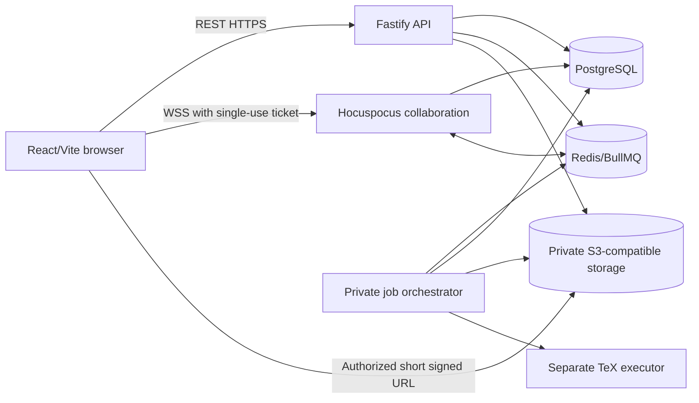

# Architecture

## Components and Data Flow



PostgreSQL owns relational data and durable CRDT updates. The object store owns immutable binary/text blobs and artifacts. Redis supports queues, pub/sub, short-lived tickets and coordination; text is not considered durable merely because Redis accepted it. Compilation reads an immutable revision, never changing buffers.

## Stack and Decisions

React, Vite, strict TypeScript, React Router, Tailwind/shadcn/Radix, TanStack Query, local React UI state, CodeMirror 6, stable Yjs 13 and compatible `y-codemirror.next`, Hocuspocus, Fastify, Zod/OpenAPI, Drizzle/PostgreSQL, Redis/BullMQ, PDF.js, pinned TeX Live/latexmk, Vitest/Testing Library/Playwright/k6. Use Zustand only after an ADR shows the need. Pin versions after checking compatibility at installation; no current package version is asserted here.

Vercel hosts the browser build. Railway is the proposed API/collaboration/jobs/database/cache/object platform; local Compose is enough to begin. Persistent WSS is hosted with collaboration. Check provider capabilities before deployment. A public executor may need a separate provider with demonstrable isolation primitives.

## Proposed Repository Structure

```text
apps/
  web/src/{app,routes,features,components,lib,styles}/
  api/src/{plugins,modules,policies,lib}/
  collab/src/{auth,persistence,awareness}/
  jobs/src/{compilation,exports,sync,maintenance}/
  tex-executor/{Dockerfile,entrypoint.sh,texmf.cnf,src/}
  git-bridge/src/                    # G4 only
packages/
  db/{src,migrations,seeds}/
  contracts/src/
  auth/src/
  latex/src/
  editor/src/
  storage/src/
  config/src/
  ui/src/                           # optional
  test-utils/src/
infra/{docker-compose.yml,railway/,scripts/,policies/}
tests/{e2e,integration,load,security,fixtures/latex-projects/}
docs/{planning,contracts,adr,operations,progress,test-reports}/
implementation/{README.md,sprint-00-bootstrap/,...,sprint-15-public-hardening/}
.github/workflows/{ci.yml,security.yml,migrations.yml}
```

## Ownership and Dependency Rules

Julio and the Project Co-owner jointly maintain the repository. The currently accountable sprint owner owns changes in its modules; no permanent frontend/backend specialization is assumed.

| Layer / module | Allowed imports | Forbidden dependencies |
|---|---|---|
| Browser and editor packages | Browser-safe contracts, UI, pure LaTeX analysis | DB, server auth implementations, storage credentials, executor modules |
| Pure policy/domain functions | Shared types and pure validation | Framework request objects, DB connections, network clients |
| API / collab / jobs adapters | Contracts, policies, DB/storage/config adapters | Importing another application's entrypoint or browser UI |
| Contracts | Zod and shared pure types | Application modules, database entities, secret-bearing configuration |
| DB / storage adapters | Contracts and runtime libraries | Browser packages; public object credentials |
| TeX executor | Explicit input/output execution contract | API/DB/Redis session secrets; host Docker socket |

Add an import-boundary lint rule in S00-T06 and verify forbidden browser imports fail. Apps depend on packages; packages never depend on apps. Sharing a DTO does not permit sharing a database entity with the browser.

## Identity and Permission Boundaries

Use opaque API-host-only cookies with `HttpOnly`, `Secure` in HTTPS environments, SameSite=Lax, exact allowed origins, and anti-CSRF protection on state-changing requests. Proposed production domains are `app.<domain>`, `api.<domain>` and `collab.<domain>` under one registrable domain. Verify preview cookie behavior with a staging proxy/domain rather than relying on third-party cookies.

The API issues short-lived one-use WSS tickets scoped to session/user/project/file. Collab consumes a ticket atomically, checks Origin and current ACL, and reapplies permissions to every mutation. Revocation publishes invalidation and disconnects or restricts active sockets. Redis is required for multi-replica coordination; do not depend on load-balancer affinity or shared local disks.

## Incremental Delivery

S00 creates a narrow browser-to-API health vertical slice with CI. S01 then delivers persisted sample retrieval behind explicit development-only access, before deeper modules. S02–S06 repeatedly extend that slice through login, projects, durable code, uploads and a real PDF. Deeper collaboration/history/visual/provider layers follow their contracts and Ready dependencies.

No Railway persistent volume is planned for replicated API/collab services. Jobs use ephemeral per-job workspaces. Verify hosting volume and replica restrictions when deploying.
